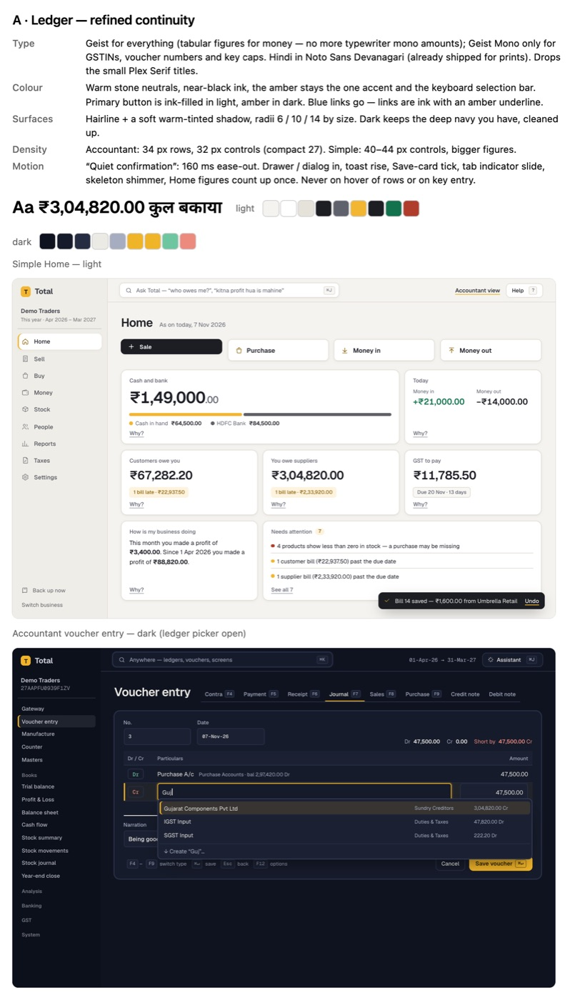

# UI / UX overhaul (Nov 2026)

Owner, 7 Nov 2026: "the app looks like dog water right now — no animations or anything. I want a
major UI and UX overhaul; use animations only where they look good." This is the UI half of the
upgrade plan's Phase 5 ("polish both modes, make them feel like one product").

## Audit of the app before the overhaul (0.12, demo seed, both modes, both themes)

What made it look cheap:

1. **Money in a typewriter face.** Every amount (Home tiles, tables, totals) was IBM Plex Mono —
   it read like a terminal, not a ledger.
2. **Small serif titles** (IBM Plex Serif at 19 px) next to a sans body — dated, and two voices.
3. **All-caps tracked labels everywhere**: field captions (CUSTOMER, BILL DATE, NO.), table
   headers, tile labels, sidebar sections, drawer sections.
4. **Blue links fighting the amber.** "Why?", "Add a discount", "See all" were default blue next
   to the amber accent — two accents.
5. **Beige slab buttons** on simple Home (four equal amber-bordered slabs, no icons) and an amber
   primary that looked disabled at a glance.
6. **No icons** anywhere in either sidebar; the simple sidebar was a plain text list.
7. **Flat, same-size cards** with a lot of dead space (Money in today tile), the content column
   floating far from the sidebar.
8. **No motion**: dialogs, toasts and menus snapped in; skeletons blinked; the only animation was
   a 16 px drawer slide.
9. **Toast**: a plain white box with coloured text, easy to miss.
10. **Inputs**: grey-filled boxes with a faint 1 px border; weak focus feedback on fields.
11. **Dark theme**: a muddy brown active pill (amber over navy) in both sidebars.
12. **Layout**: the header's business name and the sidebar logo did not share a grid; a short
    form left the Save bar floating mid-window (and a toast could sit on it — fixed in PR a).

## Direction (owner's pick: A · Ledger)

Six directions were mocked (A Ledger, B Neel, C Desk, D Bahi, E Bazaar, F Grid) as the same two
screens with real demo figures; the owner chose **A · Ledger** — refined continuity:

- **Type**: Geist (variable) for everything incl. money with tabular figures (each digit 0.6 em,
  the same as the mono face, so column widths are unchanged); Geist Mono only for GSTINs, voucher
  numbers and key caps; Noto Sans Devanagari for Hindi (loaded only for Devanagari glyphs).
  Sentence-case labels.
- **Colour**: warm stone neutrals (`--t-bg #f4f3ef`), near-black ink, the amber is the one accent
  (selection bar, focus, highlights). Primary button ink-filled in light, amber in dark. Links are
  ink with an amber underline. Dark keeps the deep navy.
- **Surfaces**: hairlines + soft warm-tinted shadows, radii 4 / 6 / 10 / 14 by size.
- **Density**: accountant unchanged (33 px rows comfortable, 27 compact); simple larger.
- **Icons**: thin 1.5–1.6 stroke line icons (PR b).
- **Motion** — "quiet confirmation": 120–220 ms ease-out, enter-only CSS keyframes, only where
  the user's action changed something (dialog / drawer / menu / toast in, save-card tick, tab
  indicator, skeleton sweep, Home figures count up once). Never on row hover or while typing; all
  off under reduced motion. No animation library.

## The PRs

- **a) Foundation** — tokens (both themes), fonts, type, radii, shadows, focus, the motion
  system, kit restyle (Button, Field / inputs, TypeAhead list, Modal, Drawer, Toast, StatTile,
  TabBar, Segmented, Badge / Chip, Skeleton, EmptyState, DataTable chrome, Popover). The pinned
  accountant-dialog snapshot now compares structure without `class` attributes (owner decision).
- **b) Shells** — simple header / sidebar (icons) / Home; accountant sidebar / Gateway / command
  palette. The accountant sidebar snapshot pins structure only (test ids + text), so icons fit.
  Audit items folded in: UX-8 (header: icon theme switch, no period chip on entry flows), UX-15
  (Home quick actions). UX-11 (the accountant sidebar scrolling its top items away) is left: pinning
  them changes the pinned sidebar structure — an owner question.
- **c) Key flows** — simple Make a bill / purchase / money / people / reports / taxes; accountant
  voucher entry, registers, reports — with empty, loading (skeletons, no layout shift) and error
  states. Owner decisions from the Nov audit (docs/audit/2026-11-audit.md): Quick bill merges into
  Make a bill; one "Ask" AI panel; interest, fixed assets and payroll PF / ESI / PT are being cut —
  those screens are not restyled.

Before / after shots of each PR live under `docs/ui/shots/<pr>/`.
